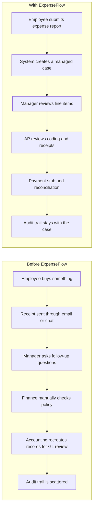
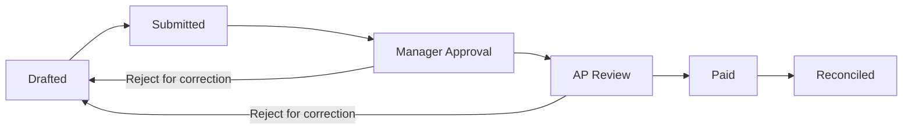
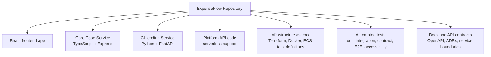
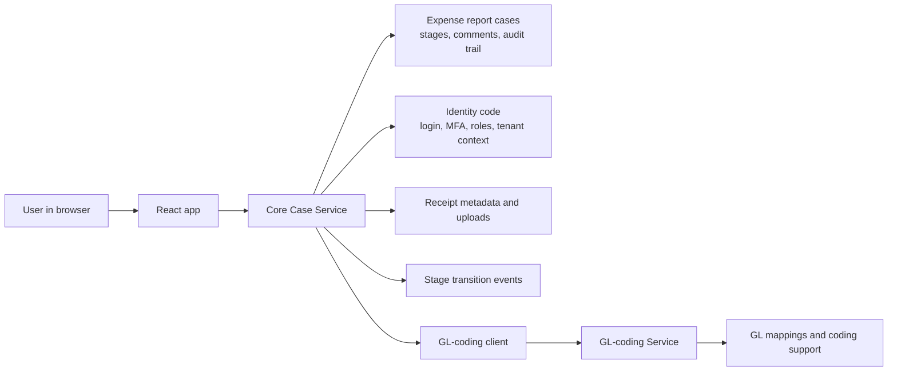
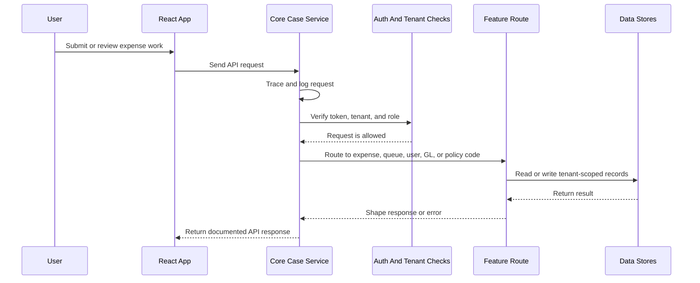
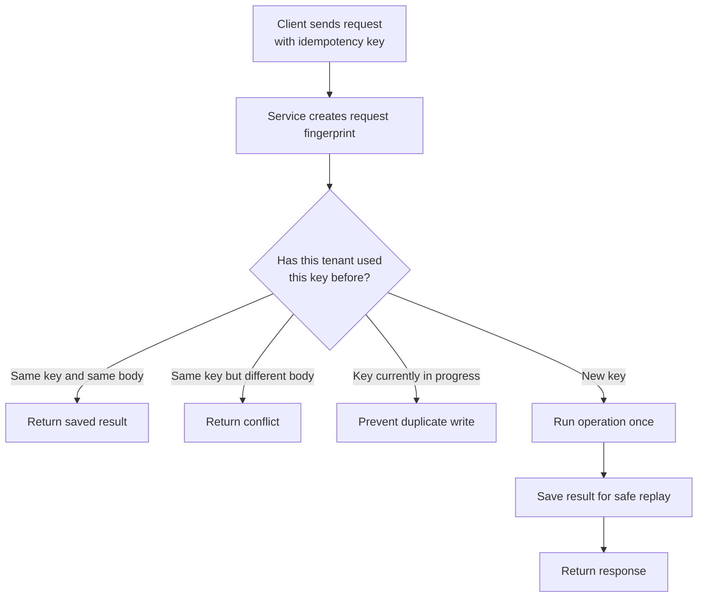
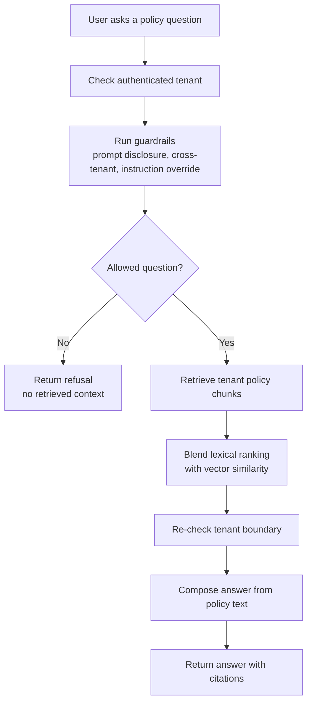
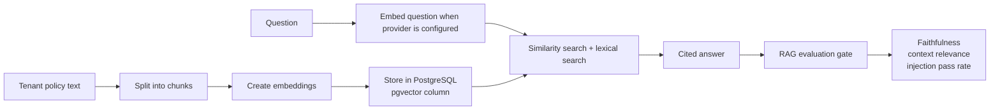

# ExpenseFlow Presentation Script

## Presentation Shape

This document is written as a speaker script with visuals that can be copied into slides. The timing target is:

- Introduction to the application: problem and solution, about 2 minutes
- Core services and repository code overview: about 7 minutes
- RAG details, embeddings, output, and demo handoff: about 2 minutes

Add application screenshots between the Mermaid diagrams where they match the live demo.

## Section 1: Introduction To The Application, Problem And Solution

### Visual: Expense Work Before And After ExpenseFlow

### Visual: Expense Report Workflow

### Speaker Script

For this presentation, I am going to start with the application itself: what problem we are solving, and why this product exists.

ExpenseFlow is built around a common finance problem. In many companies, employee expenses move through too many disconnected places. A receipt might be in an email, an approval might happen in a message thread, a policy question might be answered manually, and finance may still need to rebuild the information later for accounting and audit purposes.

That creates three problems. First, the process is slow for employees and managers. Second, finance teams have to spend time cleaning up incomplete or inconsistent submissions. Third, when someone asks what happened later, the proof is scattered across different tools.

Our solution is to treat every expense report as a managed case. A case has a stage, an owner, line items, and audit entriesleading to a clear history of transitions. It contains a simple workflow from drafted all the way to reconciled, the final stage. If a manager or AP reviewer rejects something, the case goes back to drafted so the employee can correct it.

That is the main product idea. ExpenseFlow is not just collecting forms. It is turning expense work into a controlled finance workflow where each step is visible, role-based, and auditable. Later on in the presentation, you will see how this flow shows up different based on your workplace role

## Section 2: Core Services, Code, And Repository Overview

### Visual: What Is In This Repository

### Visual: Service Responsibilities

### Visual: Request Handling In The Core Case Service

### Visual: Idempotency Protection

### Speaker Script

Now I am going to shift from the product idea to what is actually in the code.

Lets look at this from a high level. This repository contains the frontend application in REACT, A core-case and GL-coding backend service, the API contracts, the infrastructure definitions written in terraform, a generation path to gain the endpoint documentation through openAPI and the tests that prove the major pieces still work together.

This next chart I'm showing you right now, I will use as an aid as we go through the code currently within the repository. Don't worry, you won't have to keep track of it, I will have more aids to help you understand where we are currently within the repo.

Let's start with the frontend. The frontend is a React application. It includes the screens that support the demo: case queue, expense reports, finance dashboard, and more. You can see them on the side as section to select within the application and within the presented image. This is the sole way a user can interact with the application. We land currently here within the structure of our repository

Next is the core-case service. The main backend service is the Core Case Service. It is written in TypeScript with Express, and this is the service that owns the Expense Report workflow. If you ask, "Where is this report? Who can act on it? What stage is it in? What happened to it?" that is Core Case Service territory.

Inside that service you find the code for expense report routes, controllers, services, repositories, database schemas, audit entries, and more. It is the main logic piece for our application, and it is seem visually how deeply connected the logic within this service is to our app in the main chart.

Within the service, Routes handle the web request. Controllers shape the request and response and Services hold the business decisions. Repositories handle database access. Schemas validate the structure of the data. That makes the code easier to reason about because each part has a job.

There is also identity and authentication code. This includes login, MFA enrollment, refresh tokens, password hashing, and tenant membership. The important thing here is that permissions are not just controlled by the frontend. The backend checks the user's token, tenant, and role before protected routes are allowed to continue.

As I mentioned before, it does have a very big part to play in the logic and you can see that now within where we are currently in the repository.

The second service is the GL-coding service. It is written in Python with FastAPI. It is focused on accounting support: GL mapping lookup, expense line item coding, service health, authentication context, and observability. In plain English, this service helps connect an expense to the accounting categories finance needs. If your employee needs to know what a line items genuine purpose is within the curent policy, this is where they will look.

For now, we have finished speaking about the internal logic of the application. For now, let's talk about what happens to the image in dpeloyment

From a container image perspective, there are two main runtime images. The Core Case image holds compiled Node service code, production dependencies, and Drizzle migration files for that version of the service. The GL-coding image holds Python, the locked production virtual environment, and the FastAPI service code. The images deliberately avoid development-only items like test runners, local environment files, secrets, package caches, and repository history.

So when we say an image is pushed to ECR, we are not pushing the whole developer workspace. We are pushing the smallest useful runtime package for that service: the code, dependencies, and versioned assets it needs to run.

The Core Case Service also publishes an OpenAPI contract. Right now that contract includes 39 route paths. Those paths cover everything from login and MFA to an internal payment-stub settlement route.

The point of OpenAPI is that the backend has a documented contract. The frontend and other callers are not guessing what the service accepts or returns. This also gives us something concrete to test and expose through API documentation.

Before we conclude, I wish to mention the safeguards within the application as well. One specific code safeguard I can mention as an example is idempotency. Idempotency means that if the same action is submitted twice, the system should not accidentally do the work twice.

That matters because duplicate requests happen in normal applications. A user might double-click a submit button. A network call might timeout and retry. A browser might send the request again because it never saw the response.

ExpenseFlow handles that with an idempotency key and a request fingerprint. If the same tenant sends the same key with the same request body, the service can return the result it already saved. If the same key is reused with a different body, the service returns a conflict. If a matching request is already in progress, the service prevents a duplicate write.

The repository also contains event-handling code for stage transitions, and has regular testing over its entire codebase, around 149 tests in fact ranging from frontend screens to E2E browser tests.

So the main takeaway from the code overview is this: ExpenseFlow is organized around service ownership and trust. The frontend gives users the workflow. The Core Case Service owns the case lifecycle. The GL-coding service owns accounting support. Identity code protects access. API contracts document what is exposed. Idempotency prevents duplicate actions. Tests and evidence workflows help show the code is still behaving the way we expect.

## Section 3: RAG Details, Embeddings, Output, And Live Demo

### Visual: Policy Assistant RAG Flow

### Visual: Embedding And Evaluation Loop

### Speaker Script

The last piece I want to introduce in the live demo is the policy reference assistant, which uses a RAG-style flow.

RAG stands for retrieval augmented generation. In our case, that means the assistant should not answer from memory. It first retrieves relevant policy text for the authenticated tenant, then builds an answer from that retrieved policy context.

The policy content is split into chunks and stored by tenant. Each chunk can also have an embedding, which is a numeric representation of the text. Those embeddings are stored in PostgreSQL using pgvector.

When a user asks a question, retrieval uses both normal text matching and vector similarity. The text matching helps with direct keyword overlap, and the vector side helps find policy sections that are semantically related even when the exact words are different.

Tenant isolation still comes first. The system filters by the authenticated tenant before ranking, and it checks tenant ownership again before using the retrieved result. That matters because two tenants could have similar policies, but users should only receive answers from their own company's policy.

The RAG assistant also has guardrails. It refuses requests that try to reveal prompts, cross tenant boundaries, or override system instructions. If it refuses, it does not return retrieved context or citations.

Let's now have a quick look at the agent in action.

