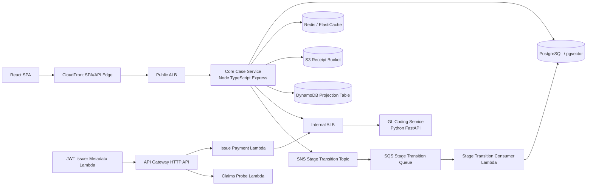

# ExpenseFlow Junior Developer Architecture Guide

This guide is written for a junior developer who is new to this repository, new
to the business domain, and still building a mental model of how frontend,
backend, infrastructure, security, observability, and deployment all connect.

It is intentionally long. You are not expected to memorize it in one sitting.
Treat it as a map you can keep open for weeks while you cross-reference source
files, tests, pull requests, ADRs, and deployment scripts.

The goal is to answer three questions over and over:

- What are we implementing?
- Why are we implementing it this way?
- How does the code, data, and deployment actually behave?

## Table Of Contents

1. [How To Use This Guide](#how-to-use-this-guide)
2. [The One-Page Mental Model](#the-one-page-mental-model)
3. [Repository Map](#repository-map)
4. [Product And Domain Model](#product-and-domain-model)
5. [System Architecture At A Glance](#system-architecture-at-a-glance)
6. [Why This Is Polyglot](#why-this-is-polyglot)
7. [Workflow 1: Sign In And Build Trusted Identity](#workflow-1-sign-in-and-build-trusted-identity)
8. [Workflow 2: Employee Creates And Submits An Expense Report](#workflow-2-employee-creates-and-submits-an-expense-report)
9. [Workflow 3: Internal Review, Flags, Deductibility, And Transitions](#workflow-3-internal-review-flags-deductibility-and-transitions)
10. [Workflow 4: Payment Stub Settlement Saga](#workflow-4-payment-stub-settlement-saga)
11. [Workflow 5: Stage-Transition Events And The Outbox](#workflow-5-stage-transition-events-and-the-outbox)
12. [Workflow 6: Policy Reference And AI Assist](#workflow-6-policy-reference-and-ai-assist)
13. [Frontend Architecture](#frontend-architecture)
14. [Core Case Service Architecture](#core-case-service-architecture)
15. [GL Coding Service Architecture](#gl-coding-service-architecture)
16. [Platform HTTP API And Lambda Architecture](#platform-http-api-and-lambda-architecture)
17. [Data Stores](#data-stores)
18. [API Contracts, Validation, And OpenAPI](#api-contracts-validation-and-openapi)
19. [Errors: RFC 9457 Problem+JSON](#errors-rfc-9457-problemjson)
20. [Security And Tenant Isolation](#security-and-tenant-isolation)
21. [Reliability Patterns](#reliability-patterns)
22. [Observability: Logs, Metrics, Correlation, And Tracing](#observability-logs-metrics-correlation-and-tracing)
23. [Local Development Runtime](#local-development-runtime)
24. [AWS Deployment Runtime](#aws-deployment-runtime)
25. [Infrastructure As Code](#infrastructure-as-code)
26. [Container Images](#container-images)
27. [Testing And Quality Gates](#testing-and-quality-gates)
28. [Security Gates And Evidence](#security-gates-and-evidence)
29. [How The System Behaves During Failures](#how-the-system-behaves-during-failures)
30. [How To Make A Safe Change](#how-to-make-a-safe-change)
31. [Month-Long Learning Path](#month-long-learning-path)
32. [Glossary](#glossary)

## How To Use This Guide

Read this guide in passes.

On the first pass, read the sections from [The One-Page Mental Model](#the-one-page-mental-model)
through [System Architecture At A Glance](#system-architecture-at-a-glance).
That gives you enough context to understand why the repository exists.

On the second pass, read the workflow sections. Workflows are the easiest way
to understand a full-stack application because they follow a real user action
through the browser, API, services, database, queues, logs, and deployed
infrastructure.

On later passes, jump to the concept chapters:

- Use [Errors: RFC 9457 Problem+JSON](#errors-rfc-9457-problemjson) when you
  touch error handling.
- Use [Reliability Patterns](#reliability-patterns) when you see idempotency,
  retries, outbox, circuit breakers, or sagas.
- Use [Observability: Logs, Metrics, Correlation, And Tracing](#observability-logs-metrics-correlation-and-tracing)
  when you are debugging a deployed request.
- Use [Infrastructure As Code](#infrastructure-as-code) when a change touches
  Terraform, ECS, ALB, RDS, Redis, CloudFront, S3, SNS, SQS, or Lambda.
- Use [Testing And Quality Gates](#testing-and-quality-gates) when you need to
  know which command proves which kind of behavior.

The code snippets are intentionally short and teaching-oriented. They show the
shape of the real implementation without replacing the actual source files.
When source and guide disagree, the source wins and this document should be
updated.

Important source documents to keep nearby:

- [README.md](../README.md)
- [AGENTS.md](../AGENTS.md)
- [docs/service-boundaries.md](service-boundaries.md)
- [docs/data-classification.md](data-classification.md)
- [docs/threat-model.md](threat-model.md)
- [docs/adr/README.md](adr/README.md)
- [docs/secure-release-gate.md](secure-release-gate.md)
- [docs/service-evidence-packets.md](service-evidence-packets.md)

## The One-Page Mental Model

ExpenseFlow is a multi-tenant expense and reimbursement workflow product for
corporate finance teams. Think of it as a case-management system where each
`Expense Report` is the primary case.

The most important product rule is this:

```text
Drafted -> Submitted -> Manager Approval -> AP Review -> Paid -> Reconciled
```

That sequence is the core workflow. `Reconciled` is terminal. Rejections at
`Manager Approval` or `AP Review` move the report backward to `Drafted`.
There is no separate `status` field. The report condition is represented by
`current_stage`.

The system has four user-facing roles:

- `Employee`: submits expenses, uploads receipts, logs mileage, comments, and
  tracks their own reports.
- `Department Manager`: reviews line items, rejects or approves, clears flags,
  edits AP-related review information, and helps move reports through internal
  review.
- `Finance Admin`: has broad tenant-level finance oversight, including case
  queue, GL mappings, users, audit trail, AP review, flags, payment stubs, and
  deductibility.
- `Admin`: platform-level role for ExpenseFlow operators. The MVP does not
  allow tenant impersonation.

The repository is split into several major runtime areas:

- `frontend/app`: the React 18 single-page application.
- `backend/core-case-service`: the Node 24 TypeScript Express service that owns
  the main Expense Report workflow, identity/auth MVP tables, audit trail,
  receipt metadata, GL result history, policy reference, and integration calls.
- `backend/python`: the Python 3.13 FastAPI GL-coding service that validates and
  computes GL account coding responses for line items and mileage.
- `platform/http-api`: serverless Node 24 Lambda/API Gateway support for shared
  JWT authorizers, claims probing, issuer metadata, and Issue Payment routing.
- `infra/terraform`: Terraform for the AWS sandbox runtime.
- `evaluation`: deterministic RAG evaluation code and datasets.
- `scripts`: local, CI, AWS, smoke-test, seed, and evidence-helper scripts.
- `docs`: architecture, ADRs, threat model, evidence, and design docs.

The most important architecture idea is bounded ownership:

- Core Case owns the `Expense Report` lifecycle.
- GL Coding owns coding logic and GL mapping outputs.
- Identity owns users, credentials, MFA, roles, and token contracts.
- Platform owns API Gateway/Lambda edges and some AWS integration glue.

The most important security idea is tenant isolation:

- Tenant scope comes from authenticated identity.
- Request bodies are not trusted for tenant scope.
- Queries, cache keys, object keys, events, and logs must preserve the tenant
  boundary.
- Tests and examples use synthetic data only.

The most important reliability idea is this:

- The database state change is authoritative.
- Cache, events, projections, and downstream calls must fail in controlled ways.
- Retried requests must not duplicate expensive or dangerous work.
- If event publishing fails after a state change commits, the outbox retries it.

## Repository Map

This section gives you a map before you start opening files. You will come back
to it often.

### Root Files

| Path | What It Is | Why It Matters |
| --- | --- | --- |
| `README.md` | Product summary and local setup guide | Start here for running the app locally |
| `AGENTS.md` | Repository contract for allowed stacks, data handling, workflow terms, AWS rules, and git rules | Treat this as governance, not optional prose |
| `package.json` | Root Node workspace scripts and shared TypeScript dependencies | Shows build/test/lint commands and workspaces |
| `pyproject.toml` | Python dependency and tool configuration | Shows Python 3.13, FastAPI, pydantic v2, pytest, mypy, ruff |
| `docker-compose.yml` | Local runtime composition | Spins up app services and local AWS-like dependencies |
| `Makefile` | Convenience automation | Check before inventing a local command |
| `vitest.config.ts` | TypeScript test projects | Separates unit, integration, production, and other test groupings |
| `playwright.config.mjs` | End-to-end browser test config | Used by UI quality gates |
| `lighthouserc.cjs` | Lighthouse quality config | Used after e2e service startup |
| `osv-scanner.toml` | Dependency vulnerability scanner policy | Root suppression policy for OSV |

### Frontend

| Path | What It Is |
| --- | --- |
| `frontend/app/src/router.tsx` | TanStack Router route tree |
| `frontend/app/src/App.tsx` | App shell, role landing behavior, sidebar shell |
| `frontend/app/src/navigation.ts` | Role-to-screen navigation map |
| `frontend/app/src/auth` | Browser auth context, auth API client, auth schemas |
| `frontend/app/src/query` | Tenant-scoped TanStack Query helpers |
| `frontend/app/src/submitExpense` | Employee expense submission UI and schemas |
| `frontend/app/src/mileage` | Employee mileage logging UI |
| `frontend/app/src/mySubmissions` | Employee portal submission tracking |
| `frontend/app/src/caseQueue` | Internal approval queue and review UI |
| `frontend/app/src/expenseReports` | Finance Admin report list, detail dialog, assist panel |
| `frontend/app/src/glMapping` | Internal GL mapping reference UI |
| `frontend/app/src/teamUsers` | Finance Admin user-management UI |
| `frontend/app/src/platformAdmin` | Platform Admin screens |
| `frontend/app/src/components` | Shared UI components |

### Core Case Service

| Path | What It Is |
| --- | --- |
| `backend/core-case-service/src/app.ts` | Express app composition, middleware, routes, docs |
| `backend/core-case-service/src/index.ts` | Service startup entry point |
| `backend/core-case-service/src/auth` | Login, MFA, refresh tokens, JWT signing/verifying |
| `backend/core-case-service/src/expenseReports` | Main domain services, controllers, routes, repositories |
| `backend/core-case-service/src/db` | Drizzle database client, schema, migrations runner |
| `backend/core-case-service/drizzle` | Checked-in SQL migrations and metadata |
| `backend/core-case-service/src/errors` | Problem+JSON domain error types and handler |
| `backend/core-case-service/src/idempotency` | Idempotency lock/result logic |
| `backend/core-case-service/src/rateLimit` | Tenant fixed-window rate limiting |
| `backend/core-case-service/src/events` | Stage-transition CloudEvents, outbox, SNS/SQS, Lambda consumer |
| `backend/core-case-service/src/cache` | Redis client and Case Queue rollup cache |
| `backend/core-case-service/src/glCoding` | TypeScript client for the Python GL Coding service |
| `backend/core-case-service/src/policyReference` | Policy reference, retrieval, embeddings, AI Assist |
| `backend/core-case-service/src/receipts` | S3-compatible receipt storage adapter |
| `backend/core-case-service/src/tinEin` | SOAP TIN/EIN anti-corruption layer and circuit breaker |
| `backend/core-case-service/src/logging` | Pino structured logging and redaction |
| `backend/core-case-service/src/tracing.ts` | OpenTelemetry trace export and downstream trace headers |
| `backend/core-case-service/src/xrayTrace.ts` | X-Ray header parsing/formatting |
| `backend/core-case-service/src/openapi` | OpenAPI generation for Core Case |
| `backend/core-case-service/src/runtimeSmoke` | Explicitly gated runtime smoke routes |

### Python GL Coding Service

| Path | What It Is |
| --- | --- |
| `backend/python/main.py` | FastAPI app, routes, dependencies, startup config |
| `backend/python/gl_coding.py` | pydantic models and GL coding computation |
| `backend/python/gl_mapping_repository.py` | Tenant-scoped PostgreSQL GL mapping lookup |
| `backend/python/auth.py` | Shared JWT verifier for Python |
| `backend/python/observability.py` | Structured metrics and OpenTelemetry/X-Ray style tracing |
| `backend/python/service_health.py` | Health response model |
| `backend/python/domain_exceptions.py` | Custom domain exceptions |
| `backend/python/Dockerfile` | Production FastAPI container image |

### Platform HTTP API

| Path | What It Is |
| --- | --- |
| `platform/http-api/template.yaml` | SAM template for shared JWT-protected HTTP API and claims probe |
| `platform/http-api/issuer-template.yaml` | SAM template for public OIDC/JWKS issuer metadata |
| `platform/http-api/issue-payment-template.yaml` | SAM template for Issue Payment Lambda route |
| `platform/http-api/src/jwtIssuer.ts` | Publishes OpenID configuration and JWKS |
| `platform/http-api/src/claimsProbe.ts` | Confirms API Gateway passes verified claims to Lambda |
| `platform/http-api/src/issuePaymentStub.ts` | Forwards public settlement request to Core Case internal route |
| `platform/http-api/src/httpApiJwtClaims.ts` | Parses roles claim formats emitted by API Gateway |

### Infrastructure

| Path | What It Is |
| --- | --- |
| `infra/terraform/bootstrap` | Remote Terraform state bucket |
| `infra/terraform/environments/sandbox` | Main sandbox environment root |
| `infra/terraform/environments/sandbox-ecr` | Persistent ECR repositories |
| `infra/terraform/modules/network` | VPC/subnet discovery or creation |
| `infra/terraform/modules/alb` | Public and internal Application Load Balancers |
| `infra/terraform/modules/ecs` | ECS Fargate, task definitions, services, logs, SNS/SQS, S3, DynamoDB |
| `infra/terraform/modules/database` | Private RDS PostgreSQL and database extras |
| `infra/terraform/modules/redis` | ElastiCache Redis and Redis URL secret |
| `infra/terraform/modules/bastion` | SSM-only bastion for private operational tasks |
| `infra/terraform/modules/lambda-stage-transition-consumer` | SQS-triggered Lambda event projection |
| `infra/terraform/modules/http-api` | HTTP API infrastructure module |
| `infra/terraform/modules/spa` | Private S3 plus CloudFront SPA hosting |
| `infra/ecs/task-definitions` | Earlier ECS task-definition templates |

### Evaluation And Tests

| Path | What It Is |
| --- | --- |
| `tests` | Python tests and root-level cross-service tests |
| `backend/core-case-service/src/**/*.test.ts` | Core Case unit/integration/production tests |
| `frontend/app/src/**/*.test.tsx` | Frontend tests |
| `tests/e2e` | Playwright browser tests |
| `evaluation/rag` | Python RAG scoring gate |
| `evaluation/datasets` | Synthetic RAG datasets |
| `pacts` | Pact contract files |
| `.github/workflows` | CI, security, evidence, e2e, RAG, and Terraform workflows |

## Product And Domain Model

ExpenseFlow Corporate is not a generic expense tracker. It is a multi-tenant
SaaS product for corporate finance teams that need clean GL-ready output and an
audit-defensible record of reimbursement work.

The product centers on case management. A case has a durable identity, an
owner, a tenant, an assigned workflow stage, review actions, comments,
attachments, receipts, audit entries, and transition logs.

### The Primary Case: Expense Report

Use the exact term `Expense Report`. Do not rename it to `Claim`, `Ticket`,
`Expense`, or `Case` in application-facing code unless an existing local type
already uses a narrower convention.

An Expense Report includes:

- Case identity.
- Tenant identity.
- Submitter or owner.
- `current_stage`.
- Due date.
- Priority.
- `on_hold`.
- `hold_reason`.
- Source line items.
- Mileage entries.
- Receipt metadata and object references.
- Comments.
- Audit trail.
- Stage-transition logs.
- GL coding results.
- Payment stub reference.

### The Workflow Stages

The only stages are:

1. `Drafted`
2. `Submitted`
3. `Manager Approval`
4. `AP Review`
5. `Paid`
6. `Reconciled`

The allowed forward path is:

```text
Drafted -> Submitted
Submitted -> Manager Approval
Manager Approval -> AP Review
AP Review -> Paid
Paid -> Reconciled
```

The allowed rejection paths are:

```text
Manager Approval -> Drafted
AP Review -> Drafted
```

There is also a compensation path used by the settlement saga:

```text
Paid -> AP Review
```

That path exists so a partially completed payment-stub settlement can return
the case to a reviewable state if reconciliation cannot finish.

The basic workflow rule exists in
`backend/core-case-service/src/expenseReports/domain/expenseReportWorkflow.ts`:

```ts
export const expenseReportWorkflowEdges = [
    ["Drafted", "Submitted"],
    ["Submitted", "Manager Approval"],
    ["Manager Approval", "AP Review"],
    ["AP Review", "Paid"],
    ["Paid", "Reconciled"],
    ["Manager Approval", "Drafted"],
    ["AP Review", "Drafted"],
] as const;
```

### Why `current_stage` Is The Source Of Truth

A common beginner design is to add both:

```text
current_stage = "AP Review"
status = "Rejected"
```

That creates ambiguity. What if `status` says `Paid` and `current_stage` says
`Manager Approval`? Which one wins?

ExpenseFlow avoids that by using `current_stage` as the source of truth. If a
report is rejected during `Manager Approval`, the transition is recorded as:

```text
Manager Approval -> Drafted
```

The audit trail explains why. There is no separate status to reconcile.

### On Hold Is Separate

`on_hold` and `hold_reason` are separate from workflow stage. A report can be in
`AP Review` and also be on hold. That does not mean there is a seventh stage
called `On Hold`.

This split matters because stages describe workflow position, while hold fields
describe a pause condition.

### MVP Boundaries

The MVP intentionally does not build everything a full enterprise expense suite
might eventually need.

Included:

- Multi-tenant isolation.
- Email/password authentication.
- MFA.
- Role-gated user flows.
- Core case workflow.
- Audit trail.
- Stage-transition logs.
- GL coding.
- Hard-coded flag rule for line items over `$500`.
- Manual deductibility.
- Payment stub.
- Policy reference and policy assist.
- Receipt upload and metadata.
- Local and AWS sandbox deployment paths.

Not included:

- SSO, SAML, OIDC login, or magic links.
- Tenant impersonation.
- General ledger system.
- Banking, card issuing, payroll, tax filing, procurement, inventory, or travel
  booking.
- Anomaly detection.
- Automated deductibility classification.
- SLA timers, escalation automation, or a separate overdue queue.

This boundary is not a lack of ambition. It is how the team keeps the MVP
reviewable and auditable while still proving the architecture.

## System Architecture At A Glance

The application has a browser frontend, a main Node API, a Python compute
service, serverless platform endpoints, and AWS infrastructure around them.



In local development, Docker Compose replaces many AWS pieces:

- PostgreSQL runs as `pgvector/pgvector:pg17`.
- Redis runs as `redis:7-alpine`.
- S3 is represented by MinIO.
- SNS/SQS are represented by LocalStack.
- DynamoDB is represented by DynamoDB Local.
- Core Case and GL Coding run as containers or local processes.
- The frontend dev server proxies `/v1` to the Core Case Service.

In AWS sandbox:

- The SPA is hosted from a private S3 bucket through CloudFront.
- Core Case runs on ECS Fargate behind a public ALB for `/v1/*`.
- GL Coding runs on ECS Fargate behind an internal ALB.
- RDS PostgreSQL stores durable data.
- ElastiCache Redis stores idempotency and cache state.
- S3 stores receipt objects.
- SNS/SQS carry stage-transition events.
- Lambda consumes SQS events into a projection table.
- API Gateway HTTP API validates JWTs before calling Lambda routes.
- CloudWatch Logs and X-Ray receive runtime evidence.

## Why This Is Polyglot

Polyglot means the system intentionally uses more than one programming language
or runtime. ExpenseFlow uses TypeScript/Node for most application workflow and
Python/FastAPI for GL coding compute.

That split can feel odd at first. A junior developer might ask: why not write
everything in one language?

That is a good question. The answer is that the repository separates
responsibilities by bounded context and chooses technology based on the shape of
that responsibility.

### Why Core Workflow Uses Node And TypeScript

The Core Case Service is workflow-heavy. It owns HTTP routing, authentication,
authorization, request validation, database transactions, audit writes, stage
transitions, receipt metadata, event outbox records, policy reference, and
service-to-service calls.

Node and TypeScript fit this service because:

- Express is a straightforward fit for route/middleware-heavy APIs.
- TypeScript gives compile-time help across DTOs, controllers, services, and
  repositories.
- Zod validates runtime inputs and creates types from schemas.
- Drizzle keeps database schema and query code close to TypeScript.
- The AWS SDK for JavaScript works naturally for S3, SNS, SQS, DynamoDB, STS,
  and Secrets Manager.
- The same language is used by the React frontend and serverless platform code,
  so shared mental models and tooling are easier.
- Node is good at I/O-heavy orchestration: receive request, validate, query DB,
  call downstream service, publish event, respond.

Core Case is not primarily a math engine. It is a coordinator and rule enforcer.
That is a strong TypeScript/Node use case.

### Why GL Coding Uses Python And FastAPI

The GL Coding Service is a focused compute and validation service. It receives
line items and mileage entries, validates them with pydantic, looks up tenant GL
mappings, computes reimbursement amounts, and returns GL coding results and
flags.

Python and FastAPI fit this service because:

- Python is strong for data validation, financial calculations, and future
  domain-compute expansion.
- pydantic v2 gives clear request and response models.
- Decimal arithmetic is natural and explicit for money-like values.
- FastAPI makes a small, typed HTTP API easy to expose and test.
- Python has a strong ecosystem for future data-processing tasks if the compute
  context grows.

The current GL-coding logic is not huge. That is okay. The point of the split is
not that Python is required for ten lines of threshold logic. The point is that
GL coding is a separate bounded context with different scaling, failure, and
evolution pressures than case workflow.

### Why Not Put GL Coding Inside Core Case?

A monolith would be simpler at first:

```ts
const results = codeLineItemsInProcess(report.lineItems);
```

But the service split gives the team:

- Clear ownership: Core Case owns workflow, GL Coding owns coding logic.
- Independent scaling: GL-coding work can scale separately if compute grows.
- Isolated failures: a compute-service crash does not necessarily take down the
  main API process.
- Contract discipline: the call between services forces request and response
  schemas to be explicit.
- Language fit: Python can own future computation without forcing the Node API
  to absorb every specialized dependency.

### What The Split Costs

The split has real costs:

- More package managers: `npm` and `uv`.
- More test styles: Vitest and pytest.
- More deployment units: two containers instead of one.
- Network latency between services.
- Retry, timeout, and 502 error handling for downstream calls.
- Contract tests to prevent drift.
- Shared JWT verification in both languages.
- More infrastructure: internal ALB, service discovery/routing, security groups,
  separate task definitions.

This is why the split should be explained and tested. Polyglot architecture is
not free. It is justified only when the boundaries are clear.

### The Important Rule

Do not split by language first. Split by ownership first.

Good:

```text
Core Case owns workflow.
GL Coding owns coding outputs.
Identity owns auth and token contracts.
```

Then choose technologies that fit those jobs.

Bad:

```text
We like Python, so put random things in Python.
We like Node, so put random things in Node.
```

ExpenseFlow is trying to follow the first pattern.

## Workflow 1: Sign In And Build Trusted Identity

A large part of this repository exists to answer one security question:

```text
Who is making this request, for which tenant, and with which role?
```

Everything else depends on that answer.

### The Browser Starts Untrusted

The frontend can show or hide UI based on the signed-in role, but the backend
must never trust the browser as the source of authorization.

The role switcher mentioned in repository rules is a design-review aid only.
Production authorization must come from authenticated identity and server-side
checks.

### Login Route

Core Case registers auth routes in `backend/core-case-service/src/app.ts`:

```ts
v1Router.use(
    "/",
    createAuthRouter(
        createLoginService(...),
        createMfaEnrollmentService(...),
        createRefreshService(...),
        createLogoutService(...),
        loadRefreshCookieConfig(),
    ),
);
```

The route factory lives in
`backend/core-case-service/src/auth/login/loginRoutes.ts` and creates:

- `POST /v1/auth/login`
- `POST /v1/auth/mfa/enroll`
- `POST /v1/auth/refresh`
- `POST /v1/auth/logout`
- deliberate `501` responses for unsupported SSO/SAML/OIDC login paths

Unsupported auth routes are important because the MVP explicitly does not
support SSO, SAML, or OIDC login. Returning a deliberate response is better than
leaving ambiguous behavior.

### Request Validation

The login request is validated with Zod:

```ts
export const LoginInboundRequestSchema = z.object({
    tenantId: z.uuid(),
    email: z.email(),
    password: z.string().min(1),
    totpCode: z.string().optional(),
});
```

This answers:

- Is the tenant ID syntactically a UUID?
- Is the email shaped like an email?
- Is a password present?
- Is the MFA code optional on the first step?

Validation does not prove the user is allowed. It only proves the incoming
shape is acceptable enough for the service to process.

### Password Verification

The login service normalizes email, loads a credential for the tenant/email
pair, and verifies the password using Argon2.

The code intentionally verifies a fallback hash when the user does not exist:

```ts
const passwordHashToVerify =
    storedCredential?.passwordHashAlgorithm === passwordHashAlgorithm
        ? storedCredential.passwordHash
        : missingCredentialPasswordHash;

const verifiedPassword =
    await passwordHasher.verifyPassword(passwordHashToVerify, request.password);
```

Why? Timing. If unknown emails returned immediately but known emails performed
Argon2 work, an attacker could measure response timing to discover which emails
exist. Performing one hash verification in both cases reduces that signal.

### MFA

MFA enrollment creates a TOTP secret, protects it, stores it, and returns an
`otpauth://` provisioning URI.

At login time:

- Missing MFA code produces an `MFA_REQUIRED` response.
- Invalid code produces an `INVALID_MFA_CODE` response.
- Accepted TOTP counter is recorded to block replay.
- Failed login or MFA attempts are recorded in `authentication_audit_entry`.

TOTP uses time windows, so a valid code changes every configured period. In this
repo the common local helper is:

```sh
npm run dev:auth:code -- manager-1
```

### Access Token And Refresh Token

When login succeeds, the service issues:

- A short-lived access token.
- A longer-lived refresh token.

The access token is returned in JSON. The refresh token is stored as an
HttpOnly cookie.

The important browser safety idea is:

```text
JavaScript can use the access token, but it should not be able to read the
refresh token cookie.
```

The cookie builder sets:

```ts
[
    "ef_refresh_token=...",
    "Path=/v1/auth",
    "Expires=...",
    "HttpOnly",
    "SameSite=Lax or None",
    "Secure when configured",
]
```

### JWT Shape

Access tokens are RS256 JWTs. That means:

- Core Case signs with a private RSA key.
- Other services verify with the public key.
- The token carries claims like issuer, audience, subject, tenant, roles, issue
  time, expiration, and token use.

Simplified claim shape:

```json
{
    "iss": "expenseflow-core-case-service",
    "aud": "expenseflow-http-api",
    "sub": "00000000-0000-4000-8000-000000000001",
    "tenant_id": "00000000-0000-4000-8000-000000000101",
    "roles": ["Finance Admin"],
    "token_use": "access",
    "iat": 1788300000,
    "exp": 1788300900
}
```

The exact values above are synthetic examples.

### JWKS

Core Case publishes public verification keys:

- `GET /v1/.well-known/jwks.json`
- `GET /v1/.well-known/openid-configuration`

The JWKS lets API Gateway and Python verify tokens without receiving the private
signing key.

### Protected Routes

In `app.ts`, protected route prefixes are wrapped with access-token middleware:

```ts
v1Router.use(
    onlyProtectedRoutes(createAccessTokenMiddleware(accessTokenVerifierConfig)),
);
```

The access-token middleware:

1. Reads the `Authorization: Bearer <token>` header.
2. Splits the token into header, payload, signature.
3. Validates `alg`, `typ`, and `kid`.
4. Finds the public key by `kid`.
5. Verifies the RS256 signature.
6. Validates the claims with Zod.
7. Checks issuer, audience, expiration, and issue time.
8. Attaches trusted identity to `req.auth`.

After this point, controllers use:

```ts
const tenantId = req.auth?.tenantId;
const userId = req.auth?.userId;
const roles = req.auth?.roles;
```

They do not trust a tenant ID in the request body.

### Python Verifies The Same JWT

The Python service has its own verifier in `backend/python/auth.py`. It checks:

- RS256 algorithm.
- `kid`.
- JWKS configuration.
- issuer.
- audience.
- expiration.
- required claims.
- role names.
- tenant ID.
- token use.

FastAPI dependencies make authenticated context available to routes:

```py
async def require_ap_review_gl_coding_context(
    context: Annotated[
        AuthenticatedRequestContext,
        Depends(require_request_context),
    ],
) -> AuthenticatedRequestContext:
    ...
```

This is how the repo enforces JWT standards across servers.

### API Gateway Also Verifies JWTs

The Platform HTTP API uses API Gateway's native JWT authorizer. This means
some Lambda routes never run unless API Gateway first verifies the token.

The claims probe exists to prove that:

```ts
return {
    statusCode: 200,
    body: JSON.stringify({
        verifiedClaims: {
            tenantIdPresent: true,
            roles,
        },
    }),
};
```

The probe intentionally confirms the tenant ID is present without returning the
tenant identifier itself.

### Why This Matters

Every meaningful backend action needs:

- Authenticated actor.
- Authenticated tenant.
- Authenticated role.
- Server-side authorization.
- Tenant-scoped database queries.

If you understand that, you understand the root security model of ExpenseFlow.

## Workflow 2: Employee Creates And Submits An Expense Report

The employee submission workflow is the best end-to-end story in the system.
It touches frontend forms, auth, idempotency, receipts, database records,
GL coding, audit trail, cache invalidation, and events.

### Step 1: Employee Opens Submit Expense

The frontend route is declared in `frontend/app/src/navigation.ts`:

```ts
{
    label: "Submit Expense",
    path: "/submit-expense",
    allowedRoles: ["Employee"],
}
```

The route tree in `frontend/app/src/router.tsx` maps that path to
`SubmitExpenseScreen`.

Frontend role gating helps the user experience. It is not the security boundary.
The API still enforces Employee access server-side.

### Step 2: Frontend Validates The Form

The submit-expense form uses Zod:

```ts
export const submitExpenseFormSchema = z.object({
    lineItems: z.array(
        z.object({
            merchant: z.string().trim().min(1).max(240),
            expenseDate: z.string().refine(
                (value) => z.iso.date().safeParse(value).success,
            ),
            category: z.enum(["Travel", "Meals", "Lodging"]),
            amount: z.coerce.number().positive().multipleOf(0.01),
            receipt: receiptFileSchema,
        }),
    ).max(50),
});
```

This prevents obvious bad inputs before a network call. The backend still
validates again, because frontend validation is a convenience, not a security
control.

### Step 3: Frontend Uses Authenticated Fetch

Frontend requests go through the `AuthProvider`:

```ts
const response = await session.authenticatedFetch("/v1/expense-reports", {
    method: "POST",
    headers: {
        "Content-Type": "application/json",
        "Idempotency-Key": idempotencyKey,
    },
    body: JSON.stringify(body),
});
```

`authenticatedFetch` adds the access token. If the token is near expiry, it
refreshes first. If a request returns `401`, it tries a refresh and retries once.

This is normal browser session behavior:

- Access tokens are short-lived.
- Refresh tokens are rotated.
- The UI avoids forcing a sign-in prompt every few minutes.

### Step 4: Core Case Creates Or Reads A Draft

Employees work on `Drafted` reports. Core Case has routes for:

- `GET /v1/expense-reports/drafts/current`
- `POST /v1/expense-reports`
- `POST /v1/expense-reports/:id/draft-content`
- `PUT /v1/expense-reports/:id/receipt-uploads/:uploadId`
- `POST /v1/expense-reports/:id/mileage-entries`
- `POST /v1/expense-reports/:id/submit`

The controller pattern is consistent:

1. Require `req.auth`.
2. Check role.
3. Validate path params, query params, headers, and body.
4. Build a service request using authenticated tenant/actor.
5. Call the domain service.
6. Return JSON or hand the error to the Problem+JSON handler.

Simplified shape:

```ts
const auth = requireAuthContext(req);
requireEmployeeAccess(auth);

const parsedRequest = AddDraftExpenseContentInboundRequestSchema.parse(req.body);

await addDraftExpenseContent({
    ...parsedRequest,
    tenantId: auth.tenantId,
    actorId: auth.userId,
    ownerId: auth.userId,
});
```

Notice that tenant and actor come from auth, not the body.

### Step 5: Idempotency Protects Retried Writes

Network requests can be retried by browsers, proxies, users, or infrastructure.
If a user clicks submit and the network drops after the server commits, the
client might retry. Without idempotency, the server could create duplicate
records or run the same submission twice.

ExpenseFlow uses an `Idempotency-Key` header for write paths like creating
reports, adding draft content, adding mileage, submitting reports, and internal
payment settlement.

The idempotency flow is:

1. Create a stable hash of the request payload.
2. Check whether a completed result exists for this tenant/key/hash.
3. Acquire a short-lived lock for this tenant/key.
4. Re-check for completed result after acquiring the lock.
5. Run the operation.
6. Save the completed result for replay.
7. Release the lock.

Simplified shape:

```ts
const result = await runIdempotentSubmission({
    tenantId: auth.tenantId,
    idempotencyKey,
    requestHash,
    store: getDefaultIdempotencyStore(),
    operation: async () => submitExpenseReport(...),
});
```

The key is tenant-scoped:

```ts
idem:{tenantId}:{idempotencyKey}
lock:{tenantId}:{idempotencyKey}
```

Why tenant-scoped? Two tenants might coincidentally use the same idempotency key.
They must not collide.

### Step 6: Receipts Store Bytes Outside PostgreSQL

Receipt upload uses raw bytes with a 10 MB route limit:

```ts
expenseReportRouter.put(
    "/expense-reports/:id/receipt-uploads/:uploadId",
    raw({ limit: 10 * 1024 * 1024, type: () => true }),
    putReceiptUpload,
);
```

The receipt object itself goes to S3-compatible storage. Locally that is MinIO;
in AWS that is S3.

The object key is server-built:

```ts
[
    "tenants",
    tenantId,
    "expense-reports",
    expenseReportId,
    "receipts",
    uploadId,
].join("/");
```

PostgreSQL stores metadata, not the binary file body. This keeps the relational
database focused on queryable business data while object storage handles file
bytes.

### Step 7: Submission Reads Draft Sources

When the employee submits, Core Case reads the draft's line items and mileage
entries. It rejects empty submissions:

```text
Add at least one expense or mileage entry before submitting.
```

If the report is no longer `Drafted`, submission fails with a conflict and a
denied submission audit entry.

### Step 8: Core Case Calls GL Coding

Before committing the submission, Core Case asks the Python GL Coding service to
code line items and mileage.

Core Case signs a service access token with the same tenant and actor and adds
the service permission `expense-report:submit`.

Simplified call:

```ts
const glResponse = await codeExpenseLineItems(
    glConfig.GL_CODING_SERVICE_BASE_URL,
    {
        line_items: sources.lineItems.map(...),
        mileage: sources.mileageEntries.map(...),
    },
    {
        accessToken,
        timeoutMs: glConfig.GL_CODING_TIMEOUT_MS,
        maxRetries: glConfig.GL_CODING_MAX_RETRIES,
        correlationId,
        parentSpan: traceSpan,
    },
);
```

Important reliability detail: external calls happen outside the database lock.
The repository re-checks `Drafted` inside the transaction before committing.
That avoids holding a database transaction open while waiting on SOAP or GL
Coding latency.

### Step 9: Python GL Coding Validates And Computes

The FastAPI route is:

```py
@app.post("/gl-coding/line-items", response_model=GlCodingComputeResponse)
async def gl_coding_line_items(
    request: GlCodingComputeRequest,
    context: Annotated[
        AuthenticatedRequestContext,
        Depends(require_ap_review_gl_coding_context),
    ],
    mapping_repository: Annotated[
        GlAccountMappingRepository,
        Depends(get_gl_account_mapping_repository),
    ],
):
    ...
```

pydantic validates each request item:

```py
class GlCodingLineItemRequest(BaseModel):
    line_item_id: UUID
    merchant: str = Field(..., min_length=1)
    amount: Decimal = Field(..., max_digits=12, decimal_places=2)
    currency: str = Field(..., min_length=3, max_length=3)
    category: ExpenseCategory
```

The service:

1. Verifies JWT.
2. Requires an internal review role or submission permission.
3. Reads GL mappings from PostgreSQL for the authenticated tenant.
4. Computes GL coding results.
5. Flags line items or mileage reimbursements over `$500.00`.
6. Returns a typed response.

### Step 10: Submission Commits

Core Case commits:

- `expense_report.current_stage = Submitted`
- submission source fingerprint
- GL coding results
- audit entries
- stage transition row
- stage transition outbox row
- employer EIN validation result, when supplied

The exact repository implementation is larger, but the important design is:

```text
The domain state change and its audit/event records are committed together.
```

That makes the database the source of truth.

### Step 11: Cache Invalidation And Outbox Dispatch

After submission commits, Core Case invalidates Case Queue rollup cache for the
tenant:

```ts
await invalidateCachedCaseQueueStageRollups(request.tenantId);
```

It also tries to dispatch the outbox event:

```ts
await dispatchOutboxEvent(outboxEventId, dependencies);
```

If dispatch fails, the request does not roll back the committed submission. The
outbox retry loop owns repair.

That pattern is explained in detail in [Workflow 5](#workflow-5-stage-transition-events-and-the-outbox).

### Step 12: Response Returns

The submission response includes the new report state, and Core Case sets the
correlation ID response header:

```ts
res.set("X-Correlation-Id", submission.correlationId);
res.status(result.statusCode).json(submission.report);
```

That correlation ID lets an operator connect frontend behavior, API logs,
downstream GL-coding logs, traces, and event records.

## Workflow 3: Internal Review, Flags, Deductibility, And Transitions

Internal users work mainly from:

- Finance Dashboard.
- Expense Reports.
- Approval Queue.
- All Transactions.
- Policy Reference.
- GL Mapping.
- Team & Users.

The internal roles are:

- `Finance Admin`
- `Department Manager`

They overlap, but they are not identical. Finance Admin has broader access,
especially around user management and report lists.

### Approval Queue

The Approval Queue reads tenant-scoped line items:

```text
GET /v1/case-queue/line-items
```

It also reads:

- audit entries
- comments
- receipts
- review detail
- rollups

The frontend files are large because this screen combines list, detail, review,
comments, receipt preview, flags, and transitions.

### Flags

The MVP flag rule is deliberately simple:

```text
Any line item or mileage reimbursement over $500 needs manual review.
```

This is not anomaly detection. Do not describe it as machine learning. Do not
build an anomaly engine for the MVP.

Python GL Coding returns flags:

```py
GlCodingFlag(
    source_id=line_item.line_item_id,
    source_type=GlSourceType.LINE_ITEM,
    code=GlCodingFlagCode.LINE_ITEM_OVER_THRESHOLD,
    message="Line item amount is above the MVP manual review threshold.",
)
```

Core Case stores those results in `gl_coding_result`.

### Clearing Flags

Internal users clear flags through:

```text
POST /v1/expense-reports/:id/flags/clear
```

The request includes source IDs and a reason. The reason matters because audit
history should explain why a manual review flag was cleared.

If a role is not permitted, the service records a denied audit entry where the
product requires it.

### Line Item And Source Review

The API supports review actions such as:

```text
POST /v1/expense-reports/:id/line-items/:sourceId/review
POST /v1/expense-reports/:id/sources/:sourceType/:sourceId/review
```

Review actions are stored on GL coding result rows:

- `line_item_review_action`
- `line_item_review_reason`
- `line_item_reviewed_by`
- `line_item_reviewed_at`

Rejected line items need a reason. That is a common auditability rule: a
negative action should explain itself.

### Manual Deductibility

Deductibility is manual in the MVP:

```text
PATCH /v1/expense-reports/:id/sources/:sourceType/:sourceId/deductibility
```

This is not automated tax classification. The system stores the human review
decision.

The service guards deductibility updates to `AP Review`:

```text
Deductibility can only be updated during AP Review.
```

That stage guard prevents a reviewer from marking accounting treatment too
early or after reconciliation.

### Stage Transitions

Internal users move reports with:

```text
POST /v1/expense-reports/:id/transitions
```

The transition service checks:

1. Report exists in authenticated tenant.
2. User role can review workflow.
3. Target stage is allowed.
4. Settlement-owned transitions are not bypassed.
5. Database transition succeeds.
6. Cache is invalidated.
7. Outbox event is dispatched or left for retry.

Simplified:

```ts
if (!canReviewWorkflow(request.roles)) {
    await insertDeniedWorkflowTransitionAttempt(...);
    throw new ForbiddenError();
}

const didTransition = await transitionExpenseReportStageInStore({
    tenantId,
    id,
    actor,
    fromStage,
    toStage,
    reason,
    correlationId,
    eventId,
});
```

Denied transition attempts matter because auditability includes both allowed
and rejected sensitive actions.

### Overdue Badge

Due dates only drive an `Overdue` badge in the queue. They do not create an SLA
engine, escalation routing, background job, or separate overdue queue.

This is a classic MVP constraint. The UI can show:

```text
This report is overdue.
```

But the product does not automatically reassign or escalate it.

## Workflow 4: Payment Stub Settlement Saga

The MVP does not integrate with a bank or payment processor. It issues a
payment stub: a synthetic reference that lets the workflow prove the `AP Review`
to `Paid` to `Reconciled` path.

The implementation is still careful because payment-like flows are sensitive.

### Public Request Path

The platform HTTP API exposes:

```text
POST /expense-reports/{id}/settlement
```

API Gateway validates the JWT with the shared authorizer. The Lambda reads
verified claims from the authorizer context:

```ts
const claims = {
    actorId: jwt.claims.sub,
    tenantId: jwt.claims.tenant_id,
    roles: parseJwtRolesClaim(jwt.claims.roles),
};
```

Then it forwards the command to Core Case over the internal ALB:

```text
POST /v1/internal/expense-reports/:id/payment-stub-settlement
```

The Lambda includes:

- `Idempotency-Key`
- `X-Correlation-Id`
- `X-Core-Case-Internal-Command-Token`
- tenant, actor, roles, and reason in JSON

### Why There Is An Internal Route

The public API route is serverless and protected by API Gateway. The actual
workflow state lives in Core Case. The internal route lets the Lambda ask Core
Case to perform the authoritative workflow mutation.

Core Case gates internal routes twice:

1. Application config must enable internal routes.
2. The request must include the internal command token.

Config gate:

```ts
if (!loadInternalRoutesConfig().enabled) {
    next(new NotFoundError("Internal routes are not enabled."));
    return;
}
```

The route is also intended to be reachable only through internal networking.

### What A Saga Is

A saga is a reliability pattern for a workflow that has multiple steps and
cannot use one database transaction for everything.

Payment settlement touches:

- Core Case database state.
- Payment stub issuance.
- Stage transition to `Paid`.
- Stage transition to `Reconciled`.
- Outbox events.
- Cache invalidation.

You cannot wrap all of that in one simple database transaction, especially once
external systems are involved. So the saga defines:

- how to start,
- what each step means,
- how to resume/reuse idempotent work,
- how to compensate if something fails after a partial step.

### Settlement Flow

Simplified:

```text
1. Claim settlement for this report and idempotency key.
2. If already reconciled, return current report.
3. If another settlement is in progress, return conflict.
4. Issue payment stub if needed.
5. Record payment reference.
6. Transition AP Review -> Paid.
7. Transition Paid -> Reconciled.
8. Mark settlement reconciled.
```

If payment was issued but reconciliation fails, compensation runs:

```text
1. Ask payment stub issuer to compensate.
2. Transition Paid -> AP Review with compensation reason.
3. Mark settlement compensated.
4. Dispatch compensation event.
5. Invalidate cache.
```

### Why This Is Not Just One Transition

The product workflow says:

```text
AP Review -> Paid -> Reconciled
```

The payment stub flow respects that. It does not jump directly from `AP Review`
to `Reconciled`. That matters because each stage has meaning:

- `AP Review`: finance/accounting review is still happening.
- `Paid`: payment reference exists.
- `Reconciled`: terminal record has been matched/closed.

Even if the MVP payment is synthetic, the audit trail should model the real
world order.

## Workflow 5: Stage-Transition Events And The Outbox

The outbox pattern is one of the most important reliability concepts in this
repo.

### The Problem

Imagine this code:

```ts
await updateReportStage("AP Review");
await sns.publish(stageTransitionEvent);
```

What happens if the database update succeeds but SNS publish fails?

You now have:

- database says the report moved,
- no event for downstream consumers.

If the request throws after the DB commit, the user might see an error even
though the report moved. If the user retries, the workflow might not be in the
same stage anymore.

This is a classic distributed-systems problem: the database and SNS cannot be
updated in one local transaction.

### The ExpenseFlow Solution

When Core Case changes a stage, it writes an outbox row in the same PostgreSQL
transaction as the stage transition.

Simplified:

```text
BEGIN;
  update expense_report set current_stage = ...
  insert into stage_transition ...
  insert into stage_transition_outbox ...
COMMIT;
```

Now the durable database contains both:

- the state change,
- the event that still needs to be published.

After commit, Core Case tries to publish the event. If publish fails, it does
not undo the workflow state. The outbox dispatcher retries later.

### The Event Contract

Stage-transition events are CloudEvents:

```json
{
    "specversion": "1.0",
    "type": "com.expenseflow.expense-report.stage-transitioned.v1",
    "source": "urn:expenseflow:core-case-service",
    "id": "00000000-0000-4000-8000-000000000201",
    "time": "2026-09-02T12:00:00.000Z",
    "subject": "expense-reports/00000000-0000-4000-8000-000000000301",
    "datacontenttype": "application/json",
    "dataschema": "urn:expenseflow:schema:events:expense-report-stage-transitioned:v1",
    "correlationid": "00000000-0000-4000-8000-000000000401",
    "data": {
        "caseId": "00000000-0000-4000-8000-000000000301",
        "tenantId": "00000000-0000-4000-8000-000000000101",
        "fromStage": "Submitted",
        "toStage": "Manager Approval",
        "correlationId": "00000000-0000-4000-8000-000000000401"
    }
}
```

The event schema validates:

- event type,
- event version,
- source,
- subject,
- tenant ID,
- stage names,
- allowed workflow edge,
- correlation ID consistency.

### Publisher

The publisher builds the CloudEvent and sends it to SNS:

```ts
await client.send(
    new PublishCommand({
        TopicArn: config.topicArn,
        Message: JSON.stringify(event),
        MessageAttributes: {
            correlationId: {
                DataType: "String",
                StringValue: event.correlationid,
            },
            eventType: {
                DataType: "String",
                StringValue: event.type,
            },
        },
    }),
);
```

SNS fanout means multiple subscribers could later consume the same transition
fact without Core Case knowing about all of them.

### Outbox Dispatcher

The dispatcher claims due events, publishes them, and marks them published:

```ts
const events = await store.claim({
    leaseMilliseconds: 30_000,
    limit: 25,
    maxAttempts: 10,
    now: new Date(),
});

for (const event of events) {
    await publishClaimedEvent(event, store, now, publisher);
}
```

If publishing fails:

- `attempt_count` increases.
- `next_attempt_at` moves into the future.
- retry delay uses exponential backoff.
- after max attempts, the event is marked dead-lettered in the outbox.

This makes publishing failure visible and repairable.

### Why The Request Path Swallows Dispatch Errors

In `expenseReportService.ts`, dispatch failures are intentionally swallowed:

```ts
try {
    await dispatchStageTransitionOutboxEvents(eventId);
} catch {
    // The durable outbox retry loop handles dispatch failures after the state change commits.
}
```

This can look strange the first time you see it. Why ignore an error?

Because the state change already committed. At that point the most truthful
response is not "the whole operation failed." The operation partly succeeded:
the workflow changed, and the event is durably queued for retry.

The outbox is the recovery mechanism.

### SQS Consumer

SNS sends events to SQS. A consumer reads a batch:

```ts
const response = await client.send(
    new ReceiveMessageCommand({
        QueueUrl: config.queueUrl,
        MaxNumberOfMessages: 10,
        WaitTimeSeconds: 20,
        MessageAttributeNames: ["All"],
    }),
);
```

For each message:

1. Parse body.
2. Validate CloudEvent.
3. Project event into `stage_transition_projection`.
4. Delete the message.

If processing fails, the message is not deleted. SQS will make it visible again
after the visibility timeout. After enough failures, it goes to the DLQ.

### Lambda Consumer

There is also a Lambda handler for SQS-triggered consumption:

```ts
export function createStageTransitionLambdaHandler(...) {
    return async (event: unknown) => {
        const parsedEvent = sqsLambdaEventSchema.parse(event);
        const batchItemFailures = [];

        for (const record of parsedEvent.Records) {
            try {
                await processStageTransitionRecord(record.body, dependencies);
            } catch {
                batchItemFailures.push({ itemIdentifier: record.messageId });
            }
        }

        return { batchItemFailures };
    };
}
```

`ReportBatchItemFailures` lets Lambda tell SQS exactly which records failed
inside a batch. Successful records do not need to be retried just because one
record failed.

### Projection

The projection store inserts by event ID:

```ts
await db
    .insert(stageTransitionProjection)
    .values(...)
    .onConflictDoNothing({
        target: stageTransitionProjection.eventId,
    });
```

That makes projection idempotent. If SQS delivers the same message twice, the
same event ID is not inserted twice.

### What To Remember

The outbox pattern separates:

- the domain fact: report stage changed,
- the integration fact: event must be published,
- the delivery mechanism: SNS/SQS/Lambda,
- the projection: read model updated from events.

It exists because distributed systems fail between steps.

## Workflow 6: Policy Reference And AI Assist

ExpenseFlow includes policy reference and assist behavior for internal users.
This is an AI-adjacent feature, but the repository is careful about grounding,
tenant isolation, and evaluation.

### Policy Reference

The basic policy-reference route is:

```text
GET /v1/policy-reference
```

Internal users can read tenant-specific policy reference content. It is
tenant-scoped. The policy corpus is stored in PostgreSQL:

- `tenant_expense_policy`
- `tenant_expense_policy_chunk`

### Policy Chunks

Policy text is split into chunks. Each chunk stores:

- tenant ID,
- policy hash,
- chunk hash,
- section,
- chunk index,
- content,
- metadata,
- optional pgvector embedding,
- embedding model,
- embedded timestamp.

Chunk hashes help keep text and embeddings consistent. If text changes, the
embedding must be regenerated.

### Retrieval

Retrieval uses a hybrid ranking:

- lexical score from token overlap, term frequency, section matching, and exact
  phrases,
- optional vector similarity through pgvector when embeddings are configured.

If embedding fails or no embedding provider is configured, retrieval falls back
to lexical-only. That is a deliberate availability decision.

Simplified retrieval:

```ts
const chunks = await repository.findTenantPolicyCorpusChunks(tenantId);
const similarityByChunkId = await findChunkSimilarities(...);

return chunks
    .filter((chunk) => chunk.tenantId === tenantId)
    .map((chunk) => rank(chunk, lexicalScore, vectorSimilarity))
    .sort(byScore);
```

The tenant filter is repeated defensively. The database query should already be
tenant-scoped, but the service re-checks returned chunks so a future repository
change cannot accidentally widen the boundary.

### pgvector

pgvector adds a `vector(1536)` column to PostgreSQL. The default model is
`text-embedding-3-small`, which produces 1536-dimensional vectors.

Important rules:

- HNSW indexes do not enforce tenant isolation.
- Similarity queries must include `tenant_id`.
- Results must be re-checked by tenant.
- Vectors from different models should not be compared.
- Changing vector width is a migration, not a config tweak.

### Assist

The Assist endpoint is:

```text
POST /v1/assist
```

The request shape:

```ts
export const AssistInboundRequestSchema = z.object({
    question: z.string().trim().min(1).max(2_000),
    caseContext: z.object({
        expenseReportId: z.uuid(),
        lineItemId: z.uuid().optional(),
    }).strict(),
}).strict();
```

The service:

1. Requires internal role.
2. Loads the Expense Report review detail for the authenticated tenant.
3. Optionally focuses on one line item.
4. Retrieves tenant policy chunks.
5. Applies guardrails.
6. Builds grounded findings and answer payload.
7. Optionally calls a configured model answerer.
8. Falls back to deterministic answer construction when needed.

### Guardrails

The assistant refuses categories such as:

- prompt disclosure,
- cross-tenant requests,
- instruction override attempts.

Retrieved policy text is treated as data, not instructions. If a retrieved
sentence contains prompt-injection instructions, it is dropped rather than
quoted.

This is a crucial AI safety idea:

```text
Documents retrieved from a tenant corpus are untrusted input.
```

### Evaluation Gate

The RAG evaluation gate runs:

```sh
npm run rag:eval
```

That performs:

1. TypeScript sample generation through the real retrieval/assistant code.
2. Python scoring in `evaluation/rag`.

The gate checks:

- faithfulness,
- context relevance,
- prompt-injection pass rate.

By default, scoring is deterministic. Live RAGAS scoring is scheduled or manual
and uses optional dependencies that are not part of the locked product runtime.

This design keeps pull-request evaluation:

- free,
- stable,
- secret-free,
- synthetic-data-only,
- reproducible.

## Frontend Architecture

The frontend is a React 18 single-page application built with Vite.

### Why React 18

React is a strong fit for this app because the user experience is stateful:

- authenticated session,
- route guards,
- forms,
- tables,
- filter state,
- detail dialogs,
- async loading/error states,
- role-specific navigation,
- query caching,
- mutations.

React 18 is the required frontend version in the repository contract.

### Why Vite

Vite gives fast local development and a simple production build. The config
proxies `/v1` to the backend in development:

```ts
server: {
    proxy: {
        "/v1": {
            changeOrigin: true,
            target: apiBaseUrl,
        },
    },
}
```

That means local frontend code can call:

```ts
session.authenticatedFetch("/v1/gl-mappings")
```

without hard-coding `http://127.0.0.1:3301` everywhere.

### Why TanStack Router

TanStack Router provides a typed route tree and route-level redirect behavior.
ExpenseFlow uses it to:

- redirect unauthenticated users to login,
- redirect authenticated users to their role landing screen,
- block navigation to screens not allowed for the user's roles,
- preserve requested paths through login when safe.

### Why TanStack Query

Most screens read API data:

- case queue rollups,
- finance trends,
- expense reports,
- transactions,
- GL mappings,
- team users,
- policy reference,
- submissions.

TanStack Query manages loading, caching, background refetching, retries, and
request cancellation.

The repo wraps it with tenant-scoped query keys:

```ts
export function createTenantQueryKey(user, keyParts) {
    return [
        "tenant",
        user.tenantId,
        "principal",
        user.id,
        "roles",
        [...user.roles].sort(),
        ...keyParts,
    ];
}
```

This matters because frontend cache data must not cross tenant, principal, or
role sessions.

### Why React Hook Form And Zod

Form-heavy screens need:

- validation messages,
- controlled inputs,
- file validation,
- repeatable line-item rows,
- clean typed values.

React Hook Form handles form state. Zod validates form values and API response
shapes.

### Screen Inventory

Finance Admin screens:

- `FinanceDashboardScreen`
- `ExpenseReportsScreen`
- `AllTransactionsScreen`
- `GlMappingScreen`
- `TeamAndUsersScreen`
- `PolicyReferenceScreen`
- `Approval Queue` through `CaseQueueScreen`

Department Manager screens:

- `Approval Queue`
- `PolicyReferenceScreen`
- `GlMappingScreen`

Employee screens:

- `MySubmissionsScreen`
- `SubmitExpenseScreen`
- `LogMileageScreen`

Platform Admin screens:

- `RolesPermissionsScreen`
- `AllTenantsScreen`
- placeholder `Audit Log`

### Frontend Authorization Is UX, Not Trust

The route checks keep the UI tidy:

```ts
if (!isPathAllowedForUser(location.pathname, session.user)) {
    return <RouteRedirect to={getDashboardPathForUser(session.user)} />;
}
```

But an attacker can call APIs without using the UI. Every backend route must
still check auth and role.

### Frontend Error Handling

Frontend query code reads Problem+JSON-like errors by looking for fields such
as:

- `detail`
- `message`
- `title`

It avoids retrying terminal client errors like auth failures or schema parse
errors.

```ts
if (error instanceof AuthRequestError && error.status === 401) {
    return false;
}

if (error instanceof QueryRequestError && isTerminalClientError(error)) {
    return false;
}
```

This prevents useless retry loops on bad requests and expired sessions.

## Core Case Service Architecture

The Core Case Service is the main backend API. It lives in
`backend/core-case-service`.

It is written in TypeScript, runs on Node 24, and uses Express 5.

### What Core Case Owns

Core Case owns:

- Expense Report identity and lifecycle.
- `current_stage`.
- draft content.
- line items.
- mileage entries.
- receipt metadata and object references.
- comments.
- audit trail.
- stage-transition logs.
- stage-transition outbox.
- GL coding result history attached to reports.
- payment settlement state.
- policy reference and policy chunks.
- team user management screens for Finance Admins.
- platform read-only summary endpoints for Admins.
- identity/auth MVP implementation.

Some of these capabilities are logically separate bounded contexts even though
they physically live in one PostgreSQL deployment during the MVP.

### Express App Composition

`app.ts` builds the app in layers:

1. CORS.
2. Request tracing.
3. HTTP request logging.
4. Auth routes.
5. Protected-route JWT middleware.
6. Protected-route tenant rate limiting.
7. JSON body parsers.
8. Internal-route gate.
9. Domain routers.
10. Health route.
11. OpenAPI and docs route.
12. Problem+JSON error handler.

Simplified:

```ts
app.use(createCorsMiddleware(loadCorsConfig()));
app.use(createRequestTracingMiddleware("core-case-service"));
app.use(httpRequestLoggingMiddleware);

v1Router.use("/", createAuthRouter(...));
v1Router.use(onlyProtectedRoutes(createAccessTokenMiddleware(...)));
v1Router.use(onlyProtectedRoutes(createTenantRateLimitMiddleware(...)));

v1Router.use("/", expenseReportRouter);
v1Router.use("/", glMappingRouter);
v1Router.use("/", teamUsersRouter);
v1Router.use("/", platformAdminRouter);

app.use("/v1", v1Router);
app.use(problemJsonErrorHandler);
```

Order matters. For example, auth middleware must run before rate limiting
because rate limiting uses `req.auth.tenantId`.

### Controllers

Controllers translate HTTP into service calls.

They should:

- require auth context,
- check role,
- parse path/query/body/header data with Zod,
- call service functions,
- set response status and headers,
- pass errors to `next(error)`.

Controllers should not contain most business logic. Business rules belong in
services and repositories so tests can exercise them without HTTP plumbing.

### Services

Services enforce domain behavior:

- create Drafted report,
- submit report,
- transition workflow,
- settle report,
- review line item,
- clear flags,
- update deductibility,
- upload/read receipt,
- read audit entries,
- read queue rollups.

Services coordinate repositories, caches, event dispatchers, downstream clients,
and error mapping.

Example: `submitExpenseReport` coordinates:

- draft source read,
- empty-submission check,
- service JWT signing,
- TIN/EIN validation,
- GL Coding call,
- database submission transaction,
- cache invalidation,
- outbox dispatch,
- error mapping to `BadGatewayError` when GL Coding fails.

### Repositories

Repositories own database details:

- Drizzle query construction.
- transactions.
- row locks.
- tenant predicates.
- audit inserts.
- stage-transition inserts.
- GL coding result inserts.
- conflict detection.

This separation lets service code speak domain language while repository code
speaks database language.

### Why Drizzle

Drizzle is used because:

- schema definitions are TypeScript code,
- application types can be inferred,
- migrations are generated and checked in,
- query code stays close to SQL,
- tenant-scoped relationships can be modeled explicitly,
- TypeScript compile checks catch many mistakes before runtime.

### OpenAPI

Core Case generates an OpenAPI document and serves it at:

```text
GET /v1/openapi.json
```

It also serves interactive docs under:

```text
GET /v1/docs
```

OpenAPI matters because:

- frontend developers can inspect API contracts,
- ZAP can scan the deployed API from the OpenAPI document,
- API review becomes easier,
- external integration behavior is explicit.

## GL Coding Service Architecture

The GL Coding Service lives in `backend/python`. It is Python 3.13 with FastAPI
and pydantic v2.

### What GL Coding Owns

GL Coding owns:

- accepted GL coding request shape,
- expense category validation,
- currency validation,
- non-negative amount checks,
- mileage reimbursement calculation,
- GL account mapping lookup,
- mapped/unmapped result classification,
- hard-coded MVP flag threshold,
- GL coding response contract.

It does not own:

- Expense Report lifecycle,
- employee submission ownership,
- comments,
- receipts,
- audit trail,
- identity records,
- payment settlement.

### FastAPI App

The app starts with a lifespan hook:

```py
@asynccontextmanager
async def lifespan(app: FastAPI):
    app.state.auth_jwt_verifier = AuthJwtVerifier.from_environment()
    app.state.mileage_reimbursement_rate = get_mileage_reimbursement_rate()
    initialize_tracing("gl-coding-service")
    yield
```

This fails fast if JWT verification is misconfigured. That is desirable because
a verifier service that cannot verify identity should not start accepting
requests.

### pydantic Models

The request model is:

```py
class GlCodingComputeRequest(BaseModel):
    line_items: list[GlCodingLineItemRequest] = Field(default_factory=list)
    mileage: list[GlCodingMileageRequest] = Field(default_factory=list)
```

The response model is:

```py
class GlCodingComputeResponse(BaseModel):
    coded_items: list[GlCodedItem]
    flags: list[GlCodingFlag]
```

pydantic gives runtime validation and clear serialized shapes.

### Decimal For Money-Like Values

The GL Coding service uses `Decimal`, not floating-point `float`, for amounts.

Why? Floating-point math can produce tiny rounding errors:

```py
0.1 + 0.2 != 0.3
```

For reimbursement amounts, cents matter. Mileage reimbursement is rounded once
after multiplication:

```py
return (distance * mileage_reimbursement_rate).quantize(
    Decimal("0.01"),
    rounding=ROUND_HALF_UP,
)
```

### Tenant-Scoped GL Mapping

The repository reads GL mappings with a tenant predicate:

```sql
SELECT mapping.category, code.account_code, code.account_name
FROM gl_mapping mapping
INNER JOIN gl_code code
    ON code.tenant_id = mapping.tenant_id
    AND code.id = mapping.gl_code_id
WHERE mapping.tenant_id = %s
    AND mapping.category = ANY(%s)
```

The tenant ID comes from authenticated context, not the request body.

### Auth Dependency

The route requires:

- `Finance Admin`, or
- `Department Manager`, or
- service permission `expense-report:submit`.

That lets internal reviewers use GL coding and lets Core Case call GL Coding
during employee submission with a service-scoped permission.

### Observability

The service logs request metrics and GL coding metrics:

- `HttpRequestCount`
- `HttpErrorCount`
- `GlCodingRequestCount`
- `GlCodingErrorCount`

It also participates in trace propagation through `X-Amzn-Trace-Id` and
correlation IDs.

## Platform HTTP API And Lambda Architecture

The platform HTTP API code lives in `platform/http-api`. It is TypeScript for
Node 24 Lambda.

### Why Serverless Here

Not every backend capability needs to live in the long-running Core Case
container. API Gateway plus Lambda is useful for:

- platform edge endpoints,
- protected probes,
- glue code,
- small commands that can be isolated,
- native JWT authorizer behavior.

The platform code is not replacing Core Case. It is a boundary around a few
AWS-native routes.

### JWT Issuer Metadata Lambda

`jwtIssuer.ts` publishes:

- `/.well-known/openid-configuration`
- `/.well-known/jwks.json`

API Gateway needs these URLs to validate JWTs. The private signing key stays
with the signer. The Lambda publishes only public verification material.

### Claims Probe Lambda

`claimsProbe.ts` confirms API Gateway validated the token and passed claims to
Lambda. It returns whether tenant ID was present and which roles were parsed.

It is a smoke-test tool, not a product feature.

### Issue Payment Lambda

`issuePaymentStub.ts` receives a public protected settlement request and
forwards it to Core Case's internal route.

It validates:

- path params,
- headers,
- body,
- environment,
- authorizer claims.

It also retrieves the internal command token from Secrets Manager. The Lambda
does not store that token in source or logs.

Simplified flow:

```text
API Gateway verifies JWT
Lambda reads verified claims
Lambda validates request
Lambda fetches internal token from Secrets Manager
Lambda POSTs to Core Case internal route
Core Case performs settlement saga
Lambda returns Core Case JSON response
```

### SAM Templates

The platform HTTP API uses AWS SAM/CloudFormation templates:

- `template.yaml`
- `issuer-template.yaml`
- `issue-payment-template.yaml`

Terraform manages most sandbox infrastructure, but SAM is used for these
serverless stacks. That is historical and practical for Lambda/API Gateway
workflows in this repo.

## Data Stores

ExpenseFlow uses storage per bounded context and storage concern.

### PostgreSQL

PostgreSQL is the authoritative store for:

- Expense Reports.
- line items.
- mileage entries.
- receipt metadata.
- comments.
- audit entries.
- stage transitions.
- stage transition outbox.
- settlement state.
- GL code and mapping reference tables.
- GL coding result history.
- policy text and chunks.
- identity/auth tables.
- tenant rate-limit windows.

Why PostgreSQL:

- transactions,
- relational constraints,
- tenant-scoped foreign keys,
- row locks,
- indexes,
- auditability,
- strong consistency,
- migrations.

Important tables:

| Table | Purpose |
| --- | --- |
| `expense_report` | Durable Expense Report aggregate root |
| `line_item` | Source expense line items |
| `mileage_entry` | Source mileage entries |
| `receipt_metadata` | Receipt metadata and object references |
| `attachment_metadata` | Generic attachment metadata |
| `case_comment` | Comments on cases |
| `audit_entry` | Audit trail |
| `stage_transition` | Stage transition history |
| `stage_transition_outbox` | Durable event-publish queue |
| `stage_transition_projection` | Event consumer projection |
| `expense_report_settlement` | Payment stub settlement state |
| `gl_code` | Tenant GL accounts |
| `gl_mapping` | Category-to-GL-code mapping |
| `gl_coding_result` | GL Coding response history |
| `tenant_expense_policy` | Tenant policy text |
| `tenant_expense_policy_chunk` | Policy chunks and optional embeddings |
| `reference_data_audit_entry` | Audit for GL mapping and user changes |
| `alert_disposition` | Records investigated/resolved alerts |
| `tenant_rate_limit_window` | Atomic tenant request counters |
| `user` | Tenant user identity |
| `credential` | Password credential hash |
| `role` | Tenant user roles |
| `refresh_token` | Refresh-token ledger |
| `mfa_enrollment` | Protected MFA TOTP secret |
| `authentication_audit_entry` | Login/MFA failure audit |

### pgvector

Local PostgreSQL uses `pgvector/pgvector:pg17`, not stock PostgreSQL, because
policy retrieval stores embeddings in a vector column.

The vector extension supports similarity ranking for policy chunks.

### Redis

Redis stores:

- idempotency locks,
- completed idempotency responses,
- Case Queue rollup cache entries,
- cache version keys.

Redis is not the source of truth. If Redis is empty, case state still exists in
PostgreSQL.

Redis helps with:

- fast repeated reads,
- short-lived coordination,
- avoiding duplicate write execution during retries.

### DynamoDB

DynamoDB stores read-optimized projection data for dashboard and queue access
patterns. The current default Case Queue path reads Redis/PostgreSQL, while the
DynamoDB case-store module exists for projection/read-model behavior and tests.

DynamoDB projections are not authoritative workflow state.

### S3 / MinIO

Receipt file bytes live in object storage:

- MinIO locally.
- S3 in AWS.

The database stores metadata and object references. The object key includes
tenant and report path segments.

### SNS/SQS / LocalStack

Stage-transition events use:

- SNS topic for publishing facts.
- SQS queue for consumers.
- SQS DLQ for repeated failures.
- LocalStack locally.

This decouples workflow mutation from downstream processing.

## API Contracts, Validation, And OpenAPI

ExpenseFlow validates request and response shapes deliberately.

### TypeScript Uses Zod

Zod appears throughout:

- controller request bodies,
- path params,
- query params,
- headers,
- config,
- JWT claims,
- event schemas,
- OpenAPI generation,
- frontend forms,
- frontend API response parsing.

Example:

```ts
const parsedRequest =
    TransitionExpenseReportWorkflowInboundRequestSchema.parse(req.body);
```

Use `parse` when invalid input should throw and flow into error handling. Use
`safeParse` when you need custom branching.

### Python Uses pydantic v2

FastAPI uses pydantic models for request/response validation:

```py
@app.post("/gl-coding/line-items", response_model=GlCodingComputeResponse)
async def gl_coding_line_items(request: GlCodingComputeRequest):
    ...
```

If the request shape is invalid, FastAPI returns a validation error before the
domain function runs.

### Runtime Validation Complements Static Types

TypeScript types disappear at runtime. A network request can still send:

```json
{ "toStage": "Definitely Not A Stage" }
```

Zod rejects that at runtime.

Static types help developers. Runtime validation protects the service.

### OpenAPI

Core Case generates OpenAPI from Zod-aware schemas and route definitions.

Why this matters:

- humans can inspect contracts,
- frontend can align with backend,
- ZAP can scan deployed routes,
- API drift is easier to notice.

### Contract Testing

GL Coding has Pact tests. Pact is useful when one service consumes another
service's API. It proves that the provider and consumer still agree about the
contract.

The Core Case TypeScript client validates both request and response:

```ts
const requestBody = GlCodingRequestSchema.parse(request);
const responseBody = await response.json();
return GlCodingResponseSchema.parse(responseBody);
```

This catches:

- Core Case sending invalid data,
- GL Coding returning invalid data,
- unexpected categories,
- missing GL account fields,
- changed flag shapes.

## Errors: RFC 9457 Problem+JSON

Your notes mentioned "RFC25s error codes." In this repository, the implemented
standard is RFC 9457 Problem Details for HTTP APIs, often called
Problem+JSON.

The media type is:

```text
application/problem+json
```

The common response shape is:

```json
{
    "type": "about:blank",
    "title": "Forbidden",
    "status": 403,
    "detail": "This action is not permitted.",
    "instance": "/v1/expense-reports/00000000-0000-4000-8000-000000000001"
}
```

### Why Use Problem+JSON

Problem+JSON gives a consistent error shape across routes.

That helps:

- frontend error display,
- API consumers,
- logs,
- tests,
- debugging,
- security review.

Without a standard, every endpoint invents its own error response.

### Core Case Error Classes

Core Case defines custom errors in
`backend/core-case-service/src/errors/problem-json.ts`:

- `NotFoundError`
- `UnauthorizedError`
- `ForbiddenError`
- `RateLimitExceededError`
- `ConflictError`
- `BadGatewayError`
- `ConfigurationError`

These are domain/application errors. Controllers and services throw them when
they know the correct HTTP meaning.

### Mapping Errors To HTTP

The error handler converts thrown errors:

| Error | HTTP Status |
| --- | --- |
| Zod validation error | `400 Bad Request` |
| `UnauthorizedError` | `401 Unauthorized` |
| `ForbiddenError` | `403 Forbidden` |
| `NotFoundError` | `404 Not Found` |
| `ConflictError` | `409 Conflict` |
| `RateLimitExceededError` | `429 Too Many Requests` |
| `BadGatewayError` | `502 Bad Gateway` |
| `ConfigurationError` | `500 Internal Server Error` |
| unknown error | `500 Internal Server Error` |

For 5xx errors, the handler logs a sanitized structured error.

### Why `BadGatewayError` For GL Coding Failure

If Core Case cannot reach GL Coding during submission, the client did not send
an invalid request and the report did not simply conflict. A downstream service
needed to complete the request failed.

That maps naturally to `502 Bad Gateway`:

```ts
if (error instanceof GlCodingServiceError) {
    throw new BadGatewayError(error.message);
}
```

### Rate Limit Retry Header

When the tenant exceeds the rate limit, the handler sets:

```text
Retry-After: <seconds>
```

The response also includes rate-limit headers:

- `RateLimit-Limit`
- `RateLimit-Remaining`
- `RateLimit-Reset`
- `X-RateLimit-Cost`

This gives clients enough information to slow down.

## Security And Tenant Isolation

Tenant isolation is the most important security property in the repository.

### The Bright Line For Data

Use only synthetic or public data in:

- prompts,
- generated code,
- tests,
- fixtures,
- logs,
- docs,
- screenshots,
- issues,
- model output.

Never place real customer, employee, tenant, vendor, payment, reimbursement,
attachment, receipt, approval, audit, bank-feed, credential, token, or secret
data in those places.

This is defined in [docs/data-classification.md](data-classification.md).

### Tenant Context Comes From Auth

The safe pattern is:

```ts
const auth = requireAuthContext(req);

await repository.readThing({
    tenantId: auth.tenantId,
    actorId: auth.userId,
});
```

The unsafe pattern is:

```ts
await repository.readThing({
    tenantId: req.body.tenantId,
});
```

The second pattern trusts the client to choose its tenant. That is forbidden for
authorization.

### Tenant-Scoped Foreign Keys

Several tables use composite relationships with both tenant ID and child ID.
Example idea:

```text
receipt_metadata(tenant_id, line_item_id)
  references line_item(tenant_id, id)
```

This prevents a receipt in one tenant from attaching to a line item in another
tenant.

### Tenant-Scoped Cache Keys

Cache keys include tenant ID:

```text
case-queue-rollup:{tenantId}:v{version}:{asOfDate}
case-queue-rollup-version:{tenantId}
idem:{tenantId}:{idempotencyKey}
lock:{tenantId}:{idempotencyKey}
```

Tenant ID in keys prevents collisions and cross-tenant cache leakage.

### Tenant-Scoped Object Keys

Receipt object keys include tenant ID:

```text
tenants/{tenantId}/expense-reports/{expenseReportId}/receipts/{uploadId}
```

Receipt retrieval still requires metadata authorization before object read. The
object key alone is not treated as permission.

### Tenant-Scoped Events

Events include tenant ID and case ID. Consumers validate schema and project
tenant-bearing events.

Never put receipt contents, payment instrument details, bank details, or raw
controlled data in event payloads.

### Role Gates

Examples:

- Employee can read their own submissions.
- Finance Admin can read report summaries.
- Finance Admin and Department Manager can access Approval Queue and GL Mapping.
- Finance Admin alone can edit GL Mapping and manage team users.
- Admin can view platform administration summaries.

The platform `Admin` role does not impersonate tenant users in the MVP.

### Threat Model

The STRIDE threat model in [docs/threat-model.md](threat-model.md) is a good
security map. It covers:

- spoofing,
- tampering,
- repudiation,
- information disclosure,
- denial of service,
- elevation of privilege.

When you change auth, tenant boundaries, events, receipts, payment stubs, logs,
IAM, or deployment, check the threat model.

## Reliability Patterns

Reliability is not one feature. It is a set of patterns that keep the product
predictable when users retry, services fail, queues redeliver messages, or AWS
replaces tasks.

### Idempotency

Idempotency means the same logical request can be retried without duplicating
the result.

ExpenseFlow uses idempotency for write paths where retries are realistic and
dangerous:

- create Expense Report,
- add draft content,
- add mileage,
- submit report,
- internal payment settlement.

Core idea:

```text
Same tenant + same idempotency key + same request hash = replay previous result.
Same tenant + same idempotency key + different request hash = conflict.
```

That protects against accidental reuse of a key for a different operation.

### Request Hashing

The service creates a canonical JSON value by sorting object keys and removing
undefined values before hashing:

```ts
createHash("sha256")
    .update(JSON.stringify(toCanonicalJsonValue(payload)))
    .digest("hex");
```

This reduces false mismatches caused by object key order.

### Timeouts

Core Case uses timeouts when calling GL Coding:

```ts
const timeoutSignal = AbortSignal.timeout(options.timeoutMs ?? 5_000);
```

Timeouts keep a downstream service from making an API request hang forever.

### Retries With Backoff

Core Case retries GL Coding on:

- `429`
- `5xx`
- network failures before max attempts

Backoff includes jitter:

```ts
const exponentialDelay = Math.min(maxBackoffMs, baseBackoffMs * 2 ** attempt);
return Math.floor(exponentialDelay / 2 + random() * (exponentialDelay / 2));
```

Jitter prevents many clients from retrying at the exact same time.

### Circuit Breaker

TIN/EIN validation uses `opossum`, a circuit breaker library.

A circuit breaker protects your service from repeatedly calling an unhealthy
downstream system. When failures cross a threshold, the breaker opens and fails
fast until a reset timeout.

This is especially useful for external services with higher latency or lower
reliability.

### Anti-Corruption Layer

The TIN/EIN adapter is also an anti-corruption layer. It turns external SOAP
concepts into ExpenseFlow concepts.

External-ish shape:

```text
TIN, TINType, LegalName, SOAP operation names, WS-Security
```

Internal shape:

```ts
{
    status: "valid" | "invalid" | "unreachable",
    isValid: boolean,
    rejectionReason?: string,
}
```

The rest of Core Case should not need to know SOAP details.

### Cache-Aside

Case Queue rollups use a cache-aside pattern:

```text
1. Try Redis.
2. If hit, return cached rollups.
3. If miss, read PostgreSQL.
4. Store derived rollups in Redis.
5. Return rollups.
```

If Redis fails, the service returns `undefined` from cache operations and falls
back to PostgreSQL.

### Versioned Cache Invalidation

Instead of deleting every possible rollup key, the cache increments a tenant
version:

```text
case-queue-rollup-version:{tenantId}
```

Rollup keys include that version. After a stage transition, the version changes,
so old cache entries no longer match the new key.

### Outbox

Outbox was explained in [Workflow 5](#workflow-5-stage-transition-events-and-the-outbox).
Remember the main idea:

```text
Commit state change and event intent together, publish later if needed.
```

### Saga

The payment-stub settlement saga was explained in
[Workflow 4](#workflow-4-payment-stub-settlement-saga). Remember:

```text
When a workflow spans multiple durable steps and external effects, define both
the happy path and the compensation path.
```

## Observability: Logs, Metrics, Correlation, And Tracing

Observability is how you understand the system after it leaves your laptop.

ExpenseFlow has several observability layers:

- structured logs,
- safe redaction,
- metric-shaped log events,
- correlation IDs,
- OpenTelemetry spans,
- X-Ray header parsing/formatting,
- CloudWatch logs,
- AWS X-Ray export through the OpenTelemetry collector.

### Structured Logging

Core Case uses Pino. It emits JSON-shaped logs instead of plain strings.

Good structured event:

```json
{
    "environment": "sandbox",
    "eventType": "http_request",
    "metricName": "HttpRequestCount",
    "metricValue": 1,
    "service": "core-case-service",
    "tenantId": "00000000-0000-4000-8000-000000000101",
    "route": "/v1/expense-reports/:id",
    "statusCode": 200
}
```

Structured logs are easier to filter in CloudWatch than prose logs.

### Redaction

The logger sanitizes:

- payment identifiers,
- payment references,
- receipt personal data,
- receipt amount-like fields in receipt context,
- email addresses in strings,
- error messages in Error objects.

This follows the data classification rule: controlled payment and receipt data
must not appear in logs, errors, traces, analytics events, queues, webhooks,
test output, generated fixtures, or prompt content.

### HTTP Request Metrics

The HTTP request logging middleware emits:

- `HttpRequestCount`
- `HttpErrorCount` for 5xx responses

It normalizes UUID path segments:

```text
/v1/expense-reports/:id/audit-entries
```

This keeps metric cardinality lower. If every UUID became a separate route in
metrics, dashboards would become noisy and expensive.

### Correlation IDs

A correlation ID ties together work across components. For a submission:

- browser receives `X-Correlation-Id`,
- Core Case logs it,
- GL Coding receives it,
- tracing records it,
- stage-transition event carries it,
- projections can store it.

Use correlation IDs to answer:

```text
Which logs and events belong to the same user action?
```

### OpenTelemetry

Both Node and Python initialize trace export only when
`OTEL_EXPORTER_OTLP_TRACES_ENDPOINT` is configured.

Core Case:

```ts
const endpoint = process.env.OTEL_EXPORTER_OTLP_TRACES_ENDPOINT?.trim();
if (!endpoint) {
    providerInitialized = true;
    return;
}
```

GL Coding has the same idea in Python.

This lets local development run without tracing infrastructure, while AWS tasks
can export traces to an OpenTelemetry collector sidecar.

### X-Ray Header Compatibility

AWS uses the `X-Amzn-Trace-Id` header. The repo can parse it into OpenTelemetry
context and format outgoing headers.

Example header:

```text
Root=1-abcdef12-0123456789abcdef01234567;Parent=0123456789abcdef;Sampled=1
```

Core Case starts a server span for incoming requests and creates child spans for
downstream GL Coding calls.

### OpenTelemetry Collector Sidecar

The ECS task definitions include an `aws-otel-collector` sidecar. Application
containers export OTLP traces to:

```text
http://127.0.0.1:4318/v1/traces
```

The collector exports to AWS X-Ray.

This sidecar design keeps app code vendor-light while still integrating with
AWS observability.

## Local Development Runtime

Local development is based on Docker Compose and optional direct service runs.

### First-Time Setup

From the root:

```sh
cp .env.example .env
./scripts/generate-dev-jwt-keys.sh
npm ci
uv sync
```

Then:

```sh
docker compose up --build
```

After services are running, seed synthetic auth accounts:

```sh
npm run dev:auth:seed
```

Optional demo data:

```sh
npm run dev:demo:seed
```

### Local Services

Docker Compose runs:

| Service | Local Purpose | Host Port |
| --- | --- | --- |
| `postgres` | PostgreSQL with pgvector | `55432` |
| `core-case-service` | Node Express API | `3301` |
| `gl-coding` | Python FastAPI API | `8001` |
| `redis` | Redis cache/idempotency | `56379` |
| `minio` | S3-compatible receipt storage | `59000` |
| `dynamodb` | DynamoDB Local | `58000` |
| `localstack` | SNS/SQS | `4566` |
| init containers | local tables, topics, buckets, seed mapping | varies |

Health checks:

```sh
curl http://127.0.0.1:3301/health
curl http://127.0.0.1:8001/health
curl http://127.0.0.1:3301/v1/openapi.json
```

### Local Frontend

Run:

```sh
npm --workspace frontend/app run dev
```

Vite proxies `/v1` to the Core Case Service. The frontend usually runs on:

```text
http://127.0.0.1:5173
```

### Synthetic Accounts

The README lists synthetic accounts such as:

- `employee@example1.invalid`
- `manager@example1.invalid`
- `finance-admin@example1.invalid`
- `platform-admin@example1.invalid`

They use a synthetic local password and MFA helper. Never replace these with
real people or real organizations in fixtures, docs, tests, or prompts.

### Resetting Local State

Stop without deleting volumes:

```sh
docker compose stop
```

Reset transient local datastore state:

```sh
docker compose down --volumes --remove-orphans
```

Use resets carefully if you have local data you wanted to inspect.

## AWS Deployment Runtime

The AWS sandbox runtime is production-shaped but still a sandbox. It creates
real AWS resources and can incur charges.

### Runtime Shape

Core components:

- CloudFront distribution for SPA.
- Private S3 bucket for SPA assets.
- Public ALB for Core Case `/v1/*`.
- Internal ALB for GL Coding and internal Core Case routes.
- ECS Fargate cluster.
- ECS Fargate service for Core Case.
- ECS Fargate service for GL Coding.
- RDS PostgreSQL.
- ElastiCache Redis.
- S3 receipt bucket.
- DynamoDB projection table.
- SNS stage-transition topic.
- SQS stage-transition queue and DLQ.
- Lambda stage-transition consumer.
- API Gateway HTTP API.
- Issue Payment Lambda.
- JWT issuer metadata Lambda.
- CloudWatch log groups.
- OpenTelemetry collector sidecars.
- Secrets Manager for sensitive runtime values.

### Public Traffic

The public API path is:

```text
Browser -> CloudFront -> Public ALB -> Core Case ECS task
```

The public ALB forwards `/v1` and `/v1/*` to Core Case.

### Private Service Traffic

Core Case calls GL Coding through the internal ALB:

```text
Core Case ECS task -> Internal ALB -> GL Coding ECS task
```

GL Coding is not exposed through the public ALB.

### Internal Command Traffic

Issue Payment Lambda calls Core Case internal routes through the internal ALB:

```text
API Gateway -> Issue Payment Lambda -> Internal ALB -> Core Case /v1/internal/*
```

That keeps internal settlement commands off the public ALB route path.

### ECS Fargate

Both services use:

- Fargate,
- `awsvpc` networking,
- Linux `X86_64`,
- 512 CPU units,
- 1024 MiB memory,
- ALB target groups,
- health checks,
- CloudWatch logs,
- Secrets Manager injection.

Fargate lets the team run containers without managing EC2 hosts, AMIs, Docker
daemon upgrades, or cluster capacity at the instance level.

### Secrets

Sensitive values are injected from Secrets Manager:

- database credentials,
- JWT private key for Core Case,
- JWKS JSON for GL Coding,
- MFA TOTP encryption key,
- Redis URL,
- internal command token,
- TIN/EIN credentials,
- runtime smoke shared secret.

Do not put secret values in Terraform files, task-definition plain environment,
logs, docs, tests, screenshots, or prompts.

### Migrations

Local Compose can auto-apply migrations for developer convenience.

ECS service tasks default to:

```text
AUTO_APPLY_MIGRATIONS=false
```

Why? In a scaled web service, multiple tasks can start during deployment. You do
not want every task racing to apply schema migrations. Production-like
migrations should run as a separate release step or one-off task using the same
image version.

## Infrastructure As Code

Most AWS sandbox infrastructure is managed with Terraform under
`infra/terraform`.

### Why Terraform

Terraform gives:

- declarative infrastructure,
- reviewable plans,
- reusable modules,
- remote state,
- drift reduction,
- CI validation,
- explicit tagging,
- clearer ownership than ad hoc scripts.

The repo previously used Bash scripts to prove sandbox runtime behavior. Those
scripts still exist for deployment glue and smoke tests, but Terraform is the
long-term infrastructure boundary.

### Bootstrap Root

`infra/terraform/bootstrap` creates the remote state S3 bucket. This has to
exist before the sandbox root can use it as a backend.

### Sandbox Root

`infra/terraform/environments/sandbox` composes modules for:

- network,
- ALBs,
- ECS,
- database,
- Redis,
- bastion,
- Lambda event consumer,
- HTTP API,
- SPA hosting.

It uses backend config from an uncommitted `backend.hcl`.

### Tags

Taggable sandbox resources must receive:

```text
env = sandbox
user = <owner>
```

The `user` tag is derived from AWS caller identity by default, with override for
CI/shared credentials.

### Network

The sandbox usually discovers an existing non-default VPC and subnets by tags.
It can also create a managed VPC when configured.

Private backend tasks run without public IPs. NAT gives them egress to pull
images, fetch secrets, write logs, and call required AWS APIs.

### ALB Module

The ALB module creates:

- public ALB,
- internal ALB,
- target groups,
- listeners,
- listener rules,
- security groups.

The public ALB routes `/v1/*` to Core Case. The internal ALB routes:

- GL Coding traffic to GL Coding,
- `/v1/internal/*` traffic to Core Case.

Runtime smoke paths can be allowlisted and blocked by explicit `403` fallback
rules.

### ECS Module

The ECS module creates:

- cluster,
- task definitions,
- ECS services,
- ECR repository references,
- IAM roles,
- security groups,
- log groups,
- receipt bucket,
- DynamoDB projection table,
- SNS/SQS event resources,
- OpenTelemetry collector sidecar config.

### Database Module

The database module creates private RDS PostgreSQL:

- encrypted storage,
- managed master password,
- DB subnet group,
- security group,
- CloudWatch log exports,
- Performance Insights KMS key,
- optional enhanced monitoring.

The database is not publicly accessible.

### Redis Module

The Redis module creates ElastiCache:

- private subnet group,
- security group,
- auth token secret,
- Redis URL secret,
- encryption at rest,
- encryption in transit.

Sandbox uses a single cache node by default to control cost.

### SPA Module

The SPA module creates:

- private S3 bucket,
- CloudFront origin access control,
- CloudFront distribution,
- SPA fallback responses,
- optional API origin behavior.

The S3 bucket is private. CloudFront reads it with signed origin access.

## Container Images

ExpenseFlow packages Core Case and GL Coding as separate container images.

### Core Case Image

Dockerfile:

```text
backend/core-case-service/Dockerfile
```

Important choices:

- `node:24-bookworm-slim`.
- digest-pinned base image.
- multi-stage build.
- `npm ci` from lockfile.
- production dependencies only in runtime.
- compiled `dist` copied to runtime.
- Drizzle migrations copied as release assets.
- unprivileged `node` user.
- health check calls `/health`.
- `AUTO_APPLY_MIGRATIONS=false` by default.

Why Debian slim instead of Alpine? Native packages such as `argon2` can run into
musl compatibility issues on Alpine. Debian slim keeps the image smaller than a
full image while avoiding that class of risk.

### GL Coding Image

Dockerfile:

```text
backend/python/Dockerfile
```

Important choices:

- `python:3.13-slim-bookworm`.
- digest-pinned Python and uv images.
- `uv sync --frozen --no-dev`.
- production virtual environment copied to runtime.
- only `backend/python` copied to runtime.
- unprivileged numeric user `10001`.
- health check calls `/health`.
- no test dependencies in runtime.

### Lambda Image

Stage-transition consumer Lambda has:

```text
backend/core-case-service/Dockerfile.lambda
```

It packages the TypeScript event handler for Lambda's Node 24 runtime.

### Why Separate Images

Separate images let Core Case and GL Coding:

- deploy independently,
- scan independently,
- produce separate SBOMs,
- sign/verify independently,
- scale independently,
- keep runtime dependencies narrow.

## Testing And Quality Gates

Testing is spread across languages and layers because the system itself is
spread across languages and layers.

### Root Test Command

```sh
npm test
```

This runs:

- TypeScript build and Vitest tests.
- Python pytest suite through `uv`.

### TypeScript Tests

Vitest covers:

- controllers,
- services,
- repositories,
- auth,
- middleware,
- tracing,
- eventing,
- OpenAPI,
- config,
- frontend components and hooks.

Some tests use Testcontainers/PostgreSQL for integration behavior.

### Python Tests

pytest covers:

- GL coding logic,
- pydantic contracts,
- auth/JWT verification,
- service health,
- observability,
- GL mapping repository,
- RAG metrics and injection gates.

Coverage fail-under is configured in `pyproject.toml`.

### Frontend Tests

Frontend tests use:

- Vitest,
- jsdom,
- Testing Library,
- axe-core,
- Playwright for e2e.

### E2E And UI Quality Gate

The e2e workflow:

```sh
npm run test:ui-gate
```

That combines:

- local services,
- e2e reset,
- Playwright tests,
- Lighthouse.

The GitHub workflow `.github/workflows/expenseflow-e2e.yml` also runs container
smoke tests before UI checks.

### Container Smoke Tests

Commands:

```sh
npm run test:container:core-case
npm run test:container:gl-coding
```

These prove the packaged images can boot and respond to health checks.

### RAG Evaluation Gate

Command:

```sh
npm run rag:eval
```

This proves policy retrieval and injection guardrails have not regressed.

### Terraform Plan Workflow

`.github/workflows/terraform-plan.yml` validates Terraform formatting, runs
Checkov/tfsec scans, validates suppression metadata, and optionally produces a
sandbox plan artifact when AWS configuration is available.

## Security Gates And Evidence

This repo treats security checks as part of engineering output.

### Secure PR Gate

`.github/workflows/secure-pr-gate.yml` runs on pull requests.

It includes:

- Semgrep for TypeScript source SAST.
- Bandit for Python SAST.
- OSV-Scanner for dependency advisories.
- Gitleaks for secrets.
- suppression metadata validation.
- scanner contract tests.

The aggregate gate fails if a scanner fails, errors, or is skipped.

### Secure Release Gate

`.github/workflows/secure-release-gate.yml` validates release-gate scripts on
relevant pull requests and scans images on pushes to `main`.

It includes:

- Trivy image vulnerability scanning.
- Syft CycloneDX SBOM generation.
- Cosign image signing.
- Cosign SBOM attestation.
- verification of signatures and attestations.

ZAP DAST runs from the manual sandbox redeploy script because ZAP needs a live
deployed target, not just a container image tarball.

### ZAP

ZAP scans the deployed Core Case public ALB using the OpenAPI document:

```text
http://<alb-dns>/v1/openapi.json
```

The scan fails on High-severity findings. The report is written to:

```text
evidence/secure-release-gate/core-case-service-zap-report.json
```

### Evidence Packets

`.github/workflows/service-evidence-packets.yml` builds evidence artifacts for:

- Core Case Service.
- GL Coding Service.

Evidence can include:

- test output,
- coverage,
- Semgrep report,
- Bandit report,
- Trivy report,
- SBOM,
- Cosign signing output,
- Cosign verification output,
- reproduction instructions.

The idea is that a release should have proof attached to it.

### Suppressions

Security suppressions are allowed only with metadata:

- owner,
- review-by date,
- reason.

Never suppress a real credential. If a credential leaks, revoke and rotate it.

## How The System Behaves During Failures

This section is important. Production systems fail. A good engineer learns what
the system does when a dependency is slow, broken, stale, or unavailable.

### If The Browser Access Token Expires

The frontend tries to refresh the session using the HttpOnly refresh token
cookie. If refresh succeeds, it retries the request. If refresh fails, the
session is invalidated and the user returns to login.

### If JWT Verification Fails In Core Case

Protected routes return `401 Unauthorized`. No tenant context is attached. Rate
limiting and domain handlers should not run as though the user were known.

### If JWT Verification Fails In GL Coding

FastAPI rejects the request. Core Case receives a non-OK downstream response or
network error and maps the submission failure to `502 Bad Gateway` when
appropriate.

### If API Gateway JWT Verification Fails

The Lambda route is not invoked. The smoke test confirms rejected tokens return
`401` before the Lambda invocation marker appears.

### If PostgreSQL Is Down

Authoritative reads and writes fail. Core Case cannot safely proceed because
PostgreSQL owns workflow state, auth state, audit records, and mappings.

In ECS, unhealthy tasks may fail health checks depending on startup behavior and
database use. Operational debugging moves to ECS task events, CloudWatch logs,
RDS status, security groups, and secrets/config.

### If Redis Is Down

Case Queue rollup cache should degrade to PostgreSQL when cache operations fail.
That can increase database load but should not corrupt business state.

Idempotency is more sensitive because Redis coordinates locks and stores replay
results. If Redis is unavailable on an idempotent write path, the request can
fail rather than risk uncontrolled duplicate execution. The authoritative
business state still belongs to PostgreSQL.

### If GL Coding Is Down

Submitting an Expense Report requires GL coding. Core Case retries with bounded
backoff. If GL Coding still fails or times out, Core Case returns a downstream
failure such as `502 Bad Gateway`.

The report should not be silently submitted without coding results because AP
Review depends on those outputs.

### If TIN/EIN Validation Is Down

The anti-corruption layer maps service failures to an `unreachable` validation
result:

```ts
{
    status: "unreachable",
    isValid: false,
    rejectionReason: "EIN validation is temporarily unavailable."
}
```

That lets submission continue with an explicit validation state rather than
crashing on an external SOAP outage. The exact product treatment depends on the
submission path and stored validation result.

### If Receipt Storage Is Down

Receipt upload or read returns a gateway/conflict-style error depending on the
operation:

- upload rejected by storage maps to `BadGatewayError`,
- metadata save that references missing uploaded object can conflict,
- read failure maps to `BadGatewayError`.

The database should not pretend a file exists if object storage verification
fails.

### If SNS Publish Fails

The outbox row remains unpublished. The request path swallows dispatch failure
after commit, because the durable outbox retry loop handles repair.

This is the "silent errors with outbox" concept from the notes. It is not
silent in the sense of unobservable. It is silent to the user request because
the domain state is already committed and recovery is asynchronous.

### If SQS Consumer Fails A Message

The message is not deleted. SQS retries it. After enough failures, the message
goes to the DLQ.

The Lambda consumer returns partial batch failures so successfully processed
records do not retry with failed ones.

### If The Event Is Delivered Twice

The projection insert uses `onConflictDoNothing` on `event_id`, so duplicate
delivery does not duplicate projection rows.

### If Cache Invalidation Fails After Reconciliation

The settlement flow has a best-effort invalidation path for final reconciliation:

```ts
try {
    await invalidateCachedCaseQueueStageRollups(tenantId);
} catch {
    // Reconciliation is already durable; cache refresh must not trigger payment compensation.
}
```

That is a subtle but important reliability decision. A cache failure should not
undo a durable payment/reconciliation workflow.

### If A Service Task Crashes In ECS

ECS service scheduler and ALB health checks replace unhealthy tasks. The system
does not rely on a single manually managed server.

You debug with:

- ECS service events,
- task logs,
- target group health,
- CloudWatch logs,
- X-Ray traces,
- security groups,
- subnets,
- Secrets Manager values,
- environment variables.

### If A Deployment Has A Bad Image Or Vulnerability

The secure release path is designed to catch this before task-definition
registration:

- Trivy scans image.
- Syft generates SBOM.
- Cosign signs and attests.
- registration verifies signature and attestation.

This is why release gates are part of architecture.

## How To Make A Safe Change

This section gives a practical workflow for changing the repo.

### 1. Check Branch

Do not change files on `development`. Feature work should happen on
`feature/*`.

```sh
git status --short --branch
```

### 2. Read The Local Contract

Check:

- `AGENTS.md`
- `docs/data-classification.md`
- relevant ADRs
- existing tests near the code

### 3. Locate The Boundary

Ask:

- Is this frontend UI?
- Is this Core Case workflow?
- Is this GL Coding compute?
- Is this Identity/Auth?
- Is this Platform HTTP API/Lambda?
- Is this Terraform or deployment?
- Is this documentation only?

Make the change where the owning boundary lives.

### 4. Preserve Tenant Isolation

For every read/write:

- Where does tenant ID come from?
- Does the query filter by tenant?
- Does a cache key include tenant?
- Does an object key include tenant?
- Does an event include tenant?
- Could one tenant infer another tenant's data?

### 5. Validate Inputs

For TypeScript APIs, define or reuse a Zod schema. For Python APIs, define or
reuse a pydantic model.

Validate:

- body,
- path params,
- query params,
- headers,
- config,
- downstream responses.

### 6. Check Authorization

Ask:

- Which role should do this?
- Is the frontend navigation aligned?
- Is the backend route enforcing the same or stricter rule?
- Does production behavior depend on a UI-only role switcher?

### 7. Check Workflow Rules

Ask:

- Does this preserve the six stage names?
- Does this use `current_stage`?
- Does this avoid adding a separate status?
- Are transitions sequence-enforced?
- Are denied transition attempts audited where required?

### 8. Check Logs

Do not log:

- payment identifiers,
- receipt contents,
- personal data,
- bank-feed data,
- tokens,
- secrets,
- raw provider error bodies that may echo private data.

Use structured, sanitized logs.

### 9. Add Tests Based On Risk

Small UI formatting change:

- component test might be enough.

Controller or service change:

- unit test plus relevant integration test.

Tenant, auth, role, event, or database change:

- integration tests with cross-tenant or denied-action coverage.

Deployment or security gate change:

- script contract test and documentation update.

### 10. Run The Right Commands

Common commands:

```sh
npm run build
npm run test:typescript
UV_CACHE_DIR=/tmp/expense-flow-uv-cache uv run pytest
npm test
npm run lint
npm run rag:eval
npm run test:e2e
```

Choose based on what changed.

## Month-Long Learning Path

This path assumes a junior developer is going to keep returning to this guide
while learning the repo.

### Week 1: Product, Local Runtime, And Frontend

Goals:

- Understand Expense Report stages.
- Understand roles.
- Run the app locally.
- Sign in with synthetic accounts.
- Navigate each role's screens.
- Trace one frontend request to one backend route.

Read:

- `README.md`
- `AGENTS.md`
- `docs/data-classification.md`
- `frontend/app/src/navigation.ts`
- `frontend/app/src/router.tsx`
- `frontend/app/src/auth/AuthContext.tsx`
- `frontend/app/src/query/queryClient.ts`

Do:

```sh
cp .env.example .env
./scripts/generate-dev-jwt-keys.sh
docker compose up --build
npm run dev:auth:seed
npm --workspace frontend/app run dev
```

Exercise:

- Sign in as an Employee.
- Open Submit Expense.
- Inspect the network calls.
- Find the matching Express routes.

### Week 2: Core Case Workflow

Goals:

- Understand controllers, services, repositories.
- Understand Zod validation.
- Understand `current_stage`.
- Understand audit entries.
- Understand idempotency.

Read:

- `backend/core-case-service/src/app.ts`
- `backend/core-case-service/src/expenseReports/routes/expenseReportRoutes.ts`
- `backend/core-case-service/src/expenseReports/controllers/expenseReportController.ts`
- `backend/core-case-service/src/expenseReports/services/expenseReportService.ts`
- `backend/core-case-service/src/expenseReports/repository/expenseReportRepository.ts`
- `backend/core-case-service/src/idempotency`
- `backend/core-case-service/src/errors/problem-json.ts`

Exercise:

- Submit one synthetic report.
- Retry the same request with the same idempotency key.
- Try a different body with the same idempotency key.
- Observe the conflict behavior.

### Week 3: Services, Events, And Reliability

Goals:

- Understand why GL Coding is Python.
- Understand service-to-service JWT.
- Understand retries and timeouts.
- Understand outbox and event projection.
- Understand cache invalidation.

Read:

- `backend/core-case-service/src/glCoding/glCodingClient.ts`
- `backend/python/main.py`
- `backend/python/gl_coding.py`
- `backend/python/auth.py`
- `backend/core-case-service/src/events`
- `backend/core-case-service/src/cache`
- `docs/service-boundaries.md`
- `docs/adr/0003-storage-per-bounded-context.md`

Exercise:

- Stop GL Coding locally and try to submit.
- Restart it and submit successfully.
- Inspect stage-transition outbox behavior.
- Run local event consumer helpers if needed.

### Week 4: Deployment, Security, And Evidence

Goals:

- Understand Docker images.
- Understand ECS Fargate runtime.
- Understand Terraform modules.
- Understand CI/security gates.
- Understand evidence packets.
- Understand observability.

Read:

- `docs/container-images-core-case-service.md`
- `docs/container-images-gl-coding-service.md`
- `docs/ecs-task-definitions.md`
- `infra/terraform/README.md`
- `infra/terraform/environments/sandbox/README.md`
- `docs/secure-pr-gate-suppressions.md`
- `docs/secure-release-gate.md`
- `docs/service-evidence-packets.md`
- `docs/threat-model.md`

Exercise:

- Build both Docker images locally.
- Read the ECS task definition Terraform.
- Follow a request path through ALB, Core Case, internal ALB, GL Coding.
- Read one security workflow file and explain what each job proves.

### After Month 1: Own A Small Feature

A good first feature is one that:

- changes one screen,
- calls one existing API,
- updates or adds one schema,
- adds focused tests,
- does not change tenant boundaries,
- does not introduce new infrastructure.

A good second feature can touch a backend route or service, as long as it adds:

- Zod/pydantic validation,
- tenant-scoped authorization,
- audit behavior if relevant,
- tests for success and denial/failure.

## Glossary

### Access Token

A short-lived JWT used to authenticate API requests.

### ADR

Architecture Decision Record. A document explaining a significant technical
decision, alternatives considered, and consequences.

### ALB

Application Load Balancer. AWS service that routes HTTP traffic to targets such
as ECS tasks.

### API Gateway HTTP API

AWS managed HTTP edge service used here for JWT-protected Lambda endpoints.

### Audit Trail

Durable records that explain who did what, when, to which Expense Report, and
with what outcome.

### Bounded Context

A domain boundary where terms, data ownership, and business rules are
consistent. Core Case and GL Coding are separate bounded contexts.

### Cache-Aside

A caching pattern where the app checks cache first, reads the source of truth on
miss, then stores the derived value back in cache.

### Circuit Breaker

A reliability pattern that stops calling an unhealthy dependency for a time
after enough failures.

### CloudEvent

A standard event envelope. ExpenseFlow uses it for stage-transition events.

### Correlation ID

An ID shared across logs, responses, downstream calls, and events for one user
action.

### CORS

Cross-Origin Resource Sharing. Browser security rules that decide whether a
frontend origin can call an API with credentials.

### DLQ

Dead-letter queue. A queue for messages that failed processing too many times.

### Drizzle

TypeScript ORM/query/migration tool used by Core Case for PostgreSQL.

### ECS Fargate

AWS serverless container runtime. It runs containers without the team managing
EC2 hosts.

### GL Coding

General-ledger coding. In this repo it maps expense categories and mileage to
tenant GL accounts and flags items over the MVP threshold.

### Idempotency

The property that retrying the same logical write request does not duplicate
the work.

### JWKS

JSON Web Key Set. A public set of keys that services use to verify JWT
signatures.

### MFA

Multi-factor authentication. This repo uses TOTP codes.

### OpenTelemetry

Vendor-neutral tracing and observability APIs.

### Outbox

A table that stores event-publish intent in the same database transaction as a
domain state change.

### pydantic

Python validation/modeling library used by FastAPI and GL Coding.

### pgvector

PostgreSQL extension for vector embeddings and similarity search.

### Problem+JSON

RFC 9457 machine-readable HTTP error format using
`application/problem+json`.

### Projection

A derived read model built from authoritative data or events.

### Refresh Token

A longer-lived token stored in an HttpOnly cookie and used to rotate sessions
and issue new access tokens.

### Saga

A reliability pattern for multi-step workflows that cannot be wrapped in one
transaction and may need compensation.

### SBOM

Software Bill of Materials. A list of packages in a built artifact.

### Tenant

One customer organization using ExpenseFlow. Tenant isolation prevents one
tenant from reading, writing, receiving, or inferring another tenant's data.

### TOTP

Time-based one-time password. A rotating MFA code generated from a shared secret.

### Zod

TypeScript runtime validation library used across backend, frontend, config,
events, and contracts.

## Final Mental Checklist

When you work in this repo, keep asking:

- What bounded context owns this behavior?
- Which role is allowed to do it?
- Which tenant is allowed to see or mutate it?
- Which schema validates the request?
- Which schema validates the response?
- Which datastore is authoritative?
- What happens if this request retries?
- What happens if the downstream service fails?
- What audit record proves what happened?
- What logs or traces help debug it?
- What test proves the important behavior?
- Does this respect the MVP boundary?

If you can answer those questions, you are thinking like an ExpenseFlow
maintainer.
